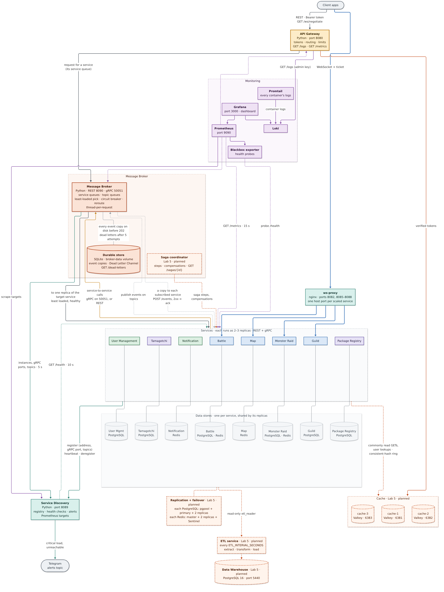

# pad-team-14-tamagotchi-go

Common Public Repository (CPR) for Team 14 — **Topic 2: Tamagotchi Go** (FAF.PAD21.1, Autumn 2026).

A distributed system of 8 microservices letting players raise, battle, and trade virtual pets ("Tamagotchis") across independently developed client apps ("packages") sharing one backend.


## Service Boundaries

### User Management Service
Owns the global identity of players: registration, authentication, profiles, friends/enemies, and both currencies (package-local currency and the shared global currency). Authoritative for identity/relationship/currency questions asked by every other service (e.g. "does this user have enough global currency?").

### Battle Service
Owns turn-based PvP combat execution once a match is created. Calculates damage from Tamagotchi level, type advantage, equipped boosts, and current health; tracks battle state/turn. Distributes rewards (global currency, XP, loser's primary Tamagotchi) at battle end. Does **not** own Tamagotchi or user records — only consults them.

### Tamagotchi Service
Owns the globally relevant state of every Tamagotchi: identity, owner, combat type (one of 6 elemental types with an advantage cycle), level, sprite reference, and package-local health stats (hunger, tiredness, happiness, etc. — intentionally *not* normalized across packages). Secondary Tamagotchis are references to existing entries, never new rows.

### Notification Service
Owns asynchronous delivery to clients via Firebase push notifications. Consumes events published by other services (friend request, nearby player, battle request, guild invite, raid started, etc.) and decides how/whether to deliver them. Does not generate the underlying events itself.

### Map Service
Owns each user's latest known geolocation and proximity detection. Shows nearby users on a map (friends/enemies always visible; unknown users become visible within ~6m). Emits proximity events that *suggest* befriending/battling. Does **not** manage battles or notifications directly — only signals opportunities for them.

### Monster Raid Service
Owns cooperative clicker-style guild raids against a shared monster: current HP, participating users, damage dealt, timestamps, raid status/duration. Distributes rewards on kill or handles raid failure on timeout. Consults Tamagotchi combat stats but doesn't own them.

### Guild Service
Owns guild identity, membership, roles (owner/officer/member), and real-time guild chat over WebSockets. Provides the social context for Monster Raids — members join an active raid with their primary Tamagotchi. Uses User Management Service to resolve identity/relationships for invitations.

### Package Registry Service
Owns the registry of client apps ("packages") participating in the ecosystem: package identifier/version/status, associated moderators/admins, and which users belong to which package. Stores each package's local Tamagotchi stat definitions/thresholds (non-normalized) so Battle Service can compute package-specific bonuses without a shared schema. Admins here design/schedule Monster Raids.

### Service Discovery
Infrastructure, not a game service (Lab 3). Knows where every running instance of every service is: instances register on start-up, keep themselves alive with heartbeats and deregister on shutdown; the API Gateway reads the live instances of a service to route to them, so services can run as several instances that are added and removed while the system runs.

## Technologies & Communication Patterns

The team works in **2 languages**, split by repo/member pair:

| Repo | Service | Language / Framework | Sync communication | Async communication |
|---|---|---|---|---|
| `user-management-service` | User Management | **Go** (e.g. Gin/Echo) | REST CRUD (auth, profile, currency checks) | Publishes friend/relationship/currency-change events for other services to consume |
| `battle-service` | Battle | **Go** (e.g. Gin/Echo) | REST to create/query a match; WebSocket pushes live turn/state updates during a match | Publishes battle-end events (reward/XP/currency change, Tamagotchi transfer) for Notification/Tamagotchi/User Management to consume |
| `tamagotchi-service` | Tamagotchi | **Go** (e.g. Gin/Echo) | REST CRUD (create/level/read stats) | Consumes `battle.ended` from the Message Broker (the winner's XP and the captured Tamagotchi); publishes none |
| `notification-service` | Notification | **Go** (e.g. Gin/Echo) | REST for device registration only | Purely event-driven: consumes events from every other service and delivers via Firebase push; no service should call it synchronously for delivery |
| `map-service` | Map | **TypeScript** (Node.js 22, Express) | REST for nearby-user queries; WebSocket/streaming for continuous geolocation updates | Emits proximity events (async, fire-and-forget) rather than blocking callers |
| `monster-raid-service` | Monster Raid | **TypeScript** (Node.js 22, Express) | REST for raid queries/attacks (current HP/status) | Publishes raid-complete/raid-failed events for rewards |
| `guild-service` | Guild | **TypeScript** (Node.js, e.g. NestJS/Express) | REST for guild/membership CRUD; WebSocket for Guild Chat (real-time, low-latency) | Publishes invite/raid-join events |
| `package-registry-service` | Package Registry | **TypeScript** (Node.js, e.g. NestJS/Express) | REST for package/moderator/stat-definition CRUD | Publishes raid-config-activated events for Monster Raid Service |

**Why this split:**
- **Go** for User Management, Battle, Tamagotchi, Notification: these are the services with the most structured, relational domain data (accounts, currencies, combat math, stat definitions), and Go's low memory footprint, fast startup, and static typing keep these always-on core services cheap to run while still giving strong compile-time guarantees around combat/currency logic where correctness matters most (e.g. atomic Tamagotchi transfer on battle end). Its built-in goroutine concurrency also handles the event consuming/publishing these services do without extra machinery.
- **TypeScript (Node.js)** for Map, Monster Raid, Guild, Package Registry: these are I/O-heavy, connection-heavy services (constant geolocation streams, guild chat WebSockets, many concurrent raid clicks) where Node's non-blocking event loop and first-class WebSocket support are a natural fit, and where the JSON-shaped, loosely-structured config data (package-specific stat definitions, raid configs) suits a more dynamic language.
- **WebSockets** are used specifically where the interaction is inherently real-time/bidirectional (Battle turn updates, Guild Chat, Monster Raid live damage) — REST elsewhere, since most other operations are simple request/response.
- **Async events** (rather than synchronous calls) are used wherever a service shouldn't block on/depend on the availability of a downstream consumer — most notably Notification Service, and reward/XP distribution after Battle or Monster Raid completes.

## Communication Contract

### Data management strategy

**Database-per-service.** Each of the 8 services owns its own database, matching the ownership boundaries above — no service reaches into another's schema directly. Cross-service data needs are resolved through synchronous REST/WebSocket calls or async events, never shared tables.

| Service | Suggested store | Why |
|---|---|---|
| User Management | PostgreSQL | Relational: accounts, currencies, friend/enemy graph, needs transactional integrity |
| Battle | PostgreSQL (+ in-memory/Redis for live match state) | Match history is relational; active turn state is ephemeral/high-churn |
| Tamagotchi | PostgreSQL | Relational ownership records; package-local stat blobs stored as JSON columns (non-normalized by design) |
| Notification | Redis / lightweight queue store | Ephemeral delivery queue, not long-term source of truth |
| Map | Redis (geospatial) | Frequently-updated key-value/geo lookups, not relational history |
| Monster Raid | PostgreSQL (+ Redis for live HP/damage counters) | Raid definition/results are relational; live damage ticking is high-frequency |
| Guild | PostgreSQL | Relational membership/roles; chat messages can go in the same store or a append-only log |
| Package Registry | PostgreSQL | Relational config data (packages, moderators, stat-definition schemas as JSON) |

All cross-service reads (e.g. Battle Service checking a user's currency) go through that owning service's REST API — never direct DB access.

### Authentication & authorization

> **Status (Lab 2):** enforced at the API Gateway. User Management, Battle, Map, Monster Raid, Guild and Package Registry run this way; the other services follow as they move behind the gateway.

There are two kinds of caller, and they never share credentials:

- **Players** (client apps) carry a **user token** issued at login.
- **Services** calling each other's internal endpoints carry a **service key**. A player token is never accepted there.

Every request — from a client or from another service — goes through the **API Gateway** (port `8080`).

#### User tokens

- **Issued by** User Management's `POST /users/login`: a JWT signed with **RS256**, valid for `JWT_TTL` (default 24 h). Claims: `sub` (the `userId`), `iat` and `exp`. Nothing else — roles are *not* in the token (see below).
- **Sent to the gateway** as `Authorization: Bearer <token>`.
- **Verified by the gateway** against User Management's public key from `GET /.well-known/jwks.json` (fetched once and cached). The gateway then **removes `Authorization`** and forwards the request with:

  | Header | Value |
  |---|---|
  | `X-User-Id` | The token's `sub` — on player requests |
  | `X-Gateway-Key` | The shared `GATEWAY_KEY` — on every forwarded request |

  Any copy of these headers a client sends is dropped, so they can't be forged.
- **Services never verify tokens.** They answer `401` to any request without a valid `X-Gateway-Key` (except `/health` and `/docs`), and take the caller from `X-User-Id`.
- **Identity comes from `X-User-Id`.** Where an endpoint also carries a `userId` (path or body), it must equal it, or the request is rejected (`403`). The `userId` fields stay in the payloads for compatibility.
- **Roles are checked by the service that owns them**, against its own data and the caller: guild roles by Guild Service, admins and package moderators by Package Registry. That's why the token doesn't carry roles, and no role data has to be synchronised between services. Since `POST /admins` itself needs an admin, Package Registry seeds the first admin from configuration (`PACKAGE_REGISTRY_INITIAL_ADMIN_USER_ID` in `.env`).

#### Service keys

Endpoints marked **Service** below are internal: only the listed callers may use them. Since Lab 4, service-to-service calls go through the **Message Broker**, not the gateway: the caller sends its own `X-Service-Key: <key>` (never a player's token) and `X-Broker-Key`, and the callee checks both — the broker key proves the call came through the broker, the service key proves *which* service made it (team decisions, #182). The broker key alone opens nothing but `POST /events`. Every caller has its own key (`SERVICE_KEY_*` in `.env`, read by both sides; placeholders only in `.env.example`), so one caller's access can be revoked without touching the others, and a key opens only the endpoints that list its service: another service's key gets `403`.

**The gateway forwards no service-to-service call** (gateway v4.2.0, Dackohn/gateway#18). The endpoints that only services call answer `404 {"error": "POST /raids is not available through the gateway"}` there, without reaching the service: `POST /users/{userId}/currency/adjust`, `POST /tamagotchis/{id}/xp`, `POST /tamagotchis/{id}/transfer-owner` and `POST /raids`. A request with only an `X-Service-Key` gets `401` like any request without a token, and the gateway drops any `X-Service-Key` or `X-Broker-Key` a client sends.

#### gRPC between services

Since Lab 4, calls between services can use gRPC instead of REST, through the Message Broker (#170, #173). The `.proto` files live in [`Dackohn/message-broker`](https://github.com/Dackohn/message-broker) under `proto/` (one package per service, `tamagotchigo.<service>.v1`, e.g. `tamagotchigo.user.v1.UserManagement`); each service keeps a copy and its generated code, pinned to a broker commit. `proto/README.md` there has the calls, the error codes and how to generate the code in Go and TypeScript.

- **Ports:** a service serves gRPC on `5008N`, next to its HTTP port `808N` (User Management `50081`), and registers it with Service Discovery as `metadata.grpcPort`. The broker listens on `50051` and forwards each call to a healthy replica's `grpcPort`, with the same load balancing, circuit breaker and reroutes as HTTP (reads only, or a call whose connection was never made).
- **Metadata:** the header names, lower-case: `x-broker-key`, `x-service-key`, `x-request-id`, `x-user-id`. The callee checks the broker key and the caller's service key, exactly as over REST, and answers `PERMISSION_DENIED` otherwise.
- **Errors:** `NOT_FOUND` (404), `INVALID_ARGUMENT` (400), `FAILED_PRECONDITION` (409, e.g. not enough currency), `PERMISSION_DENIED` (401/403), `DEADLINE_EXCEEDED` (504), `UNAVAILABLE` (503/502), `INTERNAL` (500). The last three count for the circuit breaker.
- **Who serves it now:** User Management (`GetUser`, `GetBalance`, `AdjustCurrency`, `GetRelationship`) and Tamagotchi (`GetTamagotchi`, `ListByOwner`, `GetTypeAdvantages`, `AddXp`, `TransferOwner`). Battle calls both over gRPC through the broker (`BATTLE_GRPC_DEPENDENCIES=user-management-service,tamagotchi-service`, the default). Notification serves none: no service calls it, and the broker delivers events only by HTTP (`POST /events`).

#### WebSockets

The gateway negotiates sockets but never relays them, so a long-lived connection doesn't tie it up:

```http
GET /ws/negotiate?path=/map/stream
Authorization: Bearer <token>
```

```json
{ "wsUrl": "ws://localhost:8085/map/stream?ticket=<ticket>" }
```

The client then connects to the service directly. The **ticket** is a JWT the gateway signs with `GATEWAY_KEY` (HS256):

| Claim | Meaning |
|---|---|
| `sub` | The player |
| `path` | The exact socket path it opens, e.g. `/raids/<raidId>/live` |
| `jti` | A unique id: each ticket opens **one** socket |
| `exp` | 60 s; services refuse tickets valid for more than 5 minutes |

The service verifies the signature, expiry and path, remembers used `jti`s until they expire, and then applies its own rules (participant, guild member, …).

**Replicas across machines.** When the gateway runs with `WS_URLS_FROM_DISCOVERY=true` (the main machine's [machines override](#running-across-machines)), the round-robin over all of the service's replicas, the same as HTTP, decides where the socket goes. A replica registered with an address clients can reach (an IP or a dotted host name, not loopback) gets `wsUrl` pointing at its own address, e.g. `ws://192.168.1.21:18701/guilds/<guildId>/chat?ticket=<ticket>`. A replica registered with its container hostname (the main machine's Compose replicas) gets the public URL above, and `ws-proxy` picks one of them. So sockets split like HTTP: 3 Compose replicas plus 1 extra one get them 3:1. The ticket is the same and valid on any replica. Off (the default), nothing changes.

#### Errors

Every error body is `{"error": "..."}`.

| Situation | HTTP | WebSocket |
|---|---|---|
| Token missing, malformed, expired or badly signed (at the gateway); gateway key or service key missing or wrong (at the service) | `401 Unauthorized` | connection closed with `1008` |
| Acting as someone else, or lacking the role | `403 Forbidden` | connection closed with `1008` |
| Concurrent task limit reached | `503 Service Unavailable` + `Retry-After` | connection closed with `1013` |
| A service this request needs has its circuit breaker open (see below) | `503 Service Unavailable` | — |
| Task timeout — the request, or a service it depends on, took too long | `504 Gateway Timeout` | — |

#### Circuit breaker

Every service that calls another one (Battle, Guild, Package Registry,
Tamagotchi, Map, Monster Raid) keeps **one breaker per target**, so
one failing service never pauses calls to the others. The rule is the same
everywhere:

- **Trips at 3 errors to the same target within the caller's request timeout
  × 3.5**: 10 s → 35 s for the gateway, 8 s → 28 s, 5 s → 17.5 s.
- **Errors** are timeouts, refused or broken connections and `5xx` answers. A
  `4xx` is not: the target answered, the request was wrong. A call abandoned
  because your own caller went away is not either.

| State | Calls to the target | Moves on when |
|---|---|---|
| Closed | go through; errors are counted over the window | the threshold is reached → open |
| Open | fail at once, without reaching the target; the request that needed it answers `503` | the cooldown has passed → half-open |
| Half-open | one trial call goes through, the others still fail at once | the trial succeeds → closed; it fails → open |

Each service reads `CIRCUIT_BREAKER_THRESHOLD` (`3`), the window and the
cooldown (both default to the window above) from its environment, with its
own unit (`_MS` or `_SECONDS`) and prefix in [`.env.example`](.env.example).

**Logs.** Every change of state is one line in the team log format. Tripping
is an `ERROR` naming the caller, target, endpoint, error count, window and
last error; half-open and closed are logged too:

```json
{"time":"2026-10-28T14:02:03.112Z","level":"ERROR","service":"gateway","msg":"circuit breaker tripped: calls to the service are paused","caller":"gateway","target":"tamagotchi-service","endpoint":"GET /types/advantages","errors":3,"windowSeconds":35.0,"threshold":3,"cooldownSeconds":35.0,"lastError":"tamagotchi-service is unreachable","requestId":"c41a…"}
```

**Try it:** stop a service (`docker compose stop tamagotchi-service`) and
send 3 requests to a service that needs it (e.g. a battle). They fail with
`502` or `504` and the third trips the caller's breaker. The 4th answers `503`
at once. Start the service again, and the first request after the cooldown
closes the breaker.

**Removing the failing instance — in the Message Broker (Lab 4, #168).**
Every call and event between services, and every client request too (gateway
v4.2.0), goes through the broker, so the broker keeps the breaker **per
instance**, and one broken replica never takes its healthy siblings down:

- 3 errors (the same definition as above) to the same instance within the
  window (`BROKER_REQUEST_TIMEOUT_SECONDS` × 3.5, 35 s) **remove** it: no more
  messages at once, and deregistered from Service Discovery
  (`DELETE /services/{service}/instances/{instanceId}`). The other replicas
  keep serving, and the failed message is rerouted to one of them when that is
  safe (`BROKER_MAX_REROUTES`).
- A removed replica comes back only by **registering again**: its next
  heartbeat gets `404` and it registers anew, with a newer `registeredAt`.
- No healthy instance left: a request answers `503` + `Retry-After`; an event
  waits in its queue, without using up a delivery attempt, until one is back.
- gRPC calls count too: `UNAVAILABLE`, `DEADLINE_EXCEEDED` and `INTERNAL`.
- The broker's `GET /health` shows each instance's breaker under
  `circuitBreakers`, and every removal is logged as an `ERROR` with the
  target, instance, URL, endpoint, error count and window:

```json
{"time":"2026-11-10T16:16:02.540Z","level":"ERROR","service":"message-broker","msg":"circuit breaker tripped: instance removed","requestId":"e07b…","caller":"message-broker","target":"user-management-service","instance":"5f4bb89d4b73","url":"http://5f4bb89d4b73:8081","endpoint":"GET /users/u1","errors":3,"windowSeconds":35.0,"threshold":3,"lastError":"status 503"}
```

The gateway has no breaker or replica removal of its own any more (v4.2.0,
Dackohn/gateway#18). Each service's own breakers stay per target service, in
front of the broker.

**Try it:** `docker kill` one replica of a 3-replica service (it can't
deregister itself) and send requests that reach it through the broker: its 3
turns fail and are rerouted, it is removed and deregistered at once (not after
the 30 s TTL), and every request after that goes to the other two.

Reference implementations: the broker's `app/breaker.py` (Python) and Battle's
`internal/clients/httpx/breaker.go` (Go).

#### Access per endpoint

| Access | Meaning |
|---|---|
| **Public** | No credentials |
| **Player** | Any valid user token |
| **Player (self)** | Valid user token whose `sub` is the user in the path/body (the actor) |
| **Player + role** | Valid user token, and the role shown, checked by the owning service |
| **Service** | Service key of one of the listed callers; user tokens are rejected |

| Service | Endpoint | Access |
|---|---|---|
| User Management | `POST /users/register` | Public |
| | `POST /users/login` | Public |
| | `GET /.well-known/jwks.json` | Public |
| | `GET /users/{userId}` | Player, or **Service** — Battle (both players exist), Guild (an invited member), Package Registry (a registered player) |
| | `GET /users/{userId}/currency` | Player (self), or **Service** — Battle (the stakes) |
| | `POST /users/{userId}/currency/adjust` | **Service** — Battle, Monster Raid (rewards); not routed by the gateway |
| | `POST /users/{userId}/friends/{targetId}` | Player (self) |
| | `GET /users/{userId}/friends` | Player (self) |
| | `DELETE /users/{userId}/friends/{targetId}` | Player (self) |
| | `POST /users/{userId}/enemies/{targetId}` | Player (self) |
| | `GET /users/{userId}/relationship/{targetId}` | Player (self), or **Service** — Map, Battle, Guild |
| | `POST /events` | **Message Broker** only (`X-Broker-Key`); not routed by the gateway |
| Battle | `POST /battles/challenge` | Player (self — the challenger) |
| | `POST /battles/{battleId}/accept` | Player (self — the challenged player) |
| | `GET /battles/{battleId}` | Player |
| | `POST /battles/{battleId}/action` | Player (self — a participant) |
| | `WS /battles/{battleId}/live` | Player — gateway ticket |
| Tamagotchi | `GET /types/advantages` | Public |
| | `POST /tamagotchis` | Player (self — the owner) |
| | `GET /tamagotchis/{id}` | Player, or **Service** — Monster Raid (ownership and attack power on raid joins), Battle (combat stats and equipped boosts) |
| | `GET /users/{userId}/tamagotchis` | Player, or **Service** — Battle (the player's Tamagotchis for a battle) |
| | `PATCH /users/{userId}/tamagotchis/{id}/set-primary` | Player (self — the owner) |
| | `PATCH /tamagotchis/{id}/stats` | Player (self — the owner) |
| | `POST /tamagotchis/{id}/xp` | **Service** — Battle; not routed by the gateway |
| | `POST /tamagotchis/{id}/transfer-owner` | **Service** — Battle; not routed by the gateway |
| | `POST /events` | **Message Broker** only (`X-Broker-Key`); not routed by the gateway |
| Notification | `POST /notifications/register-device` | Player (self) |
| | `GET /notifications/{userId}` | Player (self) |
| | `PATCH /notifications/{id}/read` | Player (self — the recipient) |
| | `POST /events` | **Message Broker** only (`X-Broker-Key`); not routed by the gateway |
| Map | `POST /map/location` | Player (self) |
| | `GET /map/nearby/{userId}` | Player (self) — locations are private |
| | `WS /map/stream` | Player (self) — gateway ticket; every frame's `userId` must be the ticket's player |
| Monster Raid | `POST /raids` | **Service** — Package Registry; not routed by the gateway |
| | `POST /raids/{raidId}/join` | Player (self) + member of the raid's guild |
| | `POST /raids/{raidId}/attack` | Player (self — a participant) |
| | `GET /raids/{raidId}` | Player |
| | `WS /raids/{raidId}/live` | Player — a participant of the raid, gateway ticket |
| Guild | `GET /guilds/search` | Player |
| | `POST /guilds` | Player (self — the owner) |
| | `POST /guilds/{guildId}/join` | Player (self) |
| | `POST /guilds/{guildId}/members` | Player + role: owner or officer (`invitedBy` = `sub`) |
| | `DELETE /guilds/{guildId}/members/{userId}` | Player (self) to leave; Player + role: owner or officer to remove others |
| | `GET /users/{userId}/guilds` | Player |
| | `GET /guilds/{guildId}` | Player, or **Service** — Monster Raid (checks raid joiners' membership) |
| | `PATCH /guilds/{guildId}/members/{userId}/role` | Player + role: owner |
| | `WS /guilds/{guildId}/chat` | Player + role: member of the guild (`authorId` = `sub`) |
| Package Registry | `GET /packages` | Public — needed before registering |
| | `GET /packages/{packageId}` | Public |
| | `POST /packages` | Player + role: admin |
| | `PUT /packages/{packageId}/stat-definitions` | Player + role: moderator of that package, or admin |
| | `POST /packages/{packageId}/users` | Player (self) |
| | `POST /packages/{packageId}/moderators` | Player + role: moderator of that package, or admin |
| | `POST /admins` | Player + role: admin |
| | `POST /raid-configs` | Player + role: admin |
| | `POST /raid-configs/{id}/activate` | Player + role: admin |
| | `POST /raid-configs/{id}/deactivate` | Player + role: admin |
| | `POST /raid-configs/{id}/cancel` | Player + role: admin |
| Every service | `GET /health`, `/docs` | Public |

### Endpoints

Each field below is annotated with its type (`string`, `int`, `float`, `bool`, `object`, `array<T>`, ISO 8601 timestamp, etc.).

#### User Management Service (`user-battle`, Go)

**Register a Player**

`POST` `/users/register` — Description: Creates a new player account. Payload:

```json
{
  "username": "string",
  "password": "string",
  "email": "string",
  "packageId": "string"
}
```

Success Response (201 Created):

```json
{
  "userId": "string",
  "username": "string",
  "email": "string"
}
```

**Login**

`POST` `/users/login` — Description: Authenticates a player and returns a user token: an RS256-signed JWT whose `sub` is the `userId`, expiring after `JWT_TTL`. Clients send it as `Authorization: Bearer <token>` (see [Authentication & authorization](#authentication--authorization)). Payload:

```json
{
  "username": "string",
  "password": "string"
}
```

Success Response (200 OK):

```json
{
  "token": "string",
  "userId": "string"
}
```

**Token Signing Keys**

`GET` `/.well-known/jwks.json` — Description: Publishes the public key(s) user tokens are signed with, in standard JWKS format, so every other service can verify tokens locally without the signing secret. Public; safe to cache.

Success Response (200 OK):

```json
{
  "keys": [
    {
      "kty": "RSA",
      "kid": "string",
      "use": "sig",
      "alg": "RS256",
      "n": "string",
      "e": "string"
    }
  ]
}
```

**Get Player**

`GET` `/users/{userId}` — Description: Retrieves a player's profile.

Success Response (200 OK):

```json
{
  "userId": "string",
  "username": "string",
  "profile": "string",
  "level": "int",
  "xp": "int"
}
```

**Get Currency Balance**

`GET` `/users/{userId}/currency` — Description: Retrieves a player's local and global currency balances.

Success Response (200 OK):

```json
{
  "localCurrency": "int",
  "globalCurrency": "int"
}
```

**Adjust Currency**

`POST` `/users/{userId}/currency/adjust` — Description: Applies a currency delta (positive or negative) to a player. `idempotencyKey` is required for adjustments originating from async events (`BattleEnded`, `RaidCompleted`) — those events may be redelivered at least once, and a repeated key must no-op rather than reapplying the delta, or a redelivered reward event double-pays a player. Payload:

```json
{
  "globalCurrencyDelta": "int",
  "localCurrencyDelta": "int",
  "reason": "string",
  "idempotencyKey": "string"
}
```

Success Response (200 OK):

```json
{
  "localCurrency": "int",
  "globalCurrency": "int"
}
```

**Send Friend Request**

`POST` `/users/{userId}/friends/{targetId}` — Description: Sends or accepts a friend request between two players.

Success Response (200 OK):

```json
{
  "status": "string (enum: pending, friends)"
}
```

**List Friends**

`GET` `/users/{userId}/friends` — Description: Lists a player's friends.

Success Response (200 OK):

```json
[
  {
    "userId": "string",
    "username": "string",
    "status": "string"
  }
]
```

**Get Relationship**

`GET` `/users/{userId}/relationship/{targetId}` — Description: Returns the relationship between two players.

Success Response (200 OK):

```json
{
  "relationship": "string (enum: friend, enemy, none)"
}
```

**Remove Relationship**

`DELETE` `/users/{userId}/friends/{targetId}` — Description: Cancels a pending friend request, or ends an existing friendship. Previously the only friend-related mutation was additive (pending → friends); this closes the gap where a request could never be rejected or reversed.

Success Response (200 OK):

```json
{
  "relationship": "string (enum: none)"
}
```

**Mark as Enemy**

`POST` `/users/{userId}/enemies/{targetId}` — Description: Marks another player as an enemy (e.g. after a proximity-suggested battle, or a manual block). Required so that Map Service's "friends/enemies always visible" rule has an `enemy` state to actually visualize — previously only `friend` had a write path.

Success Response (200 OK):

```json
{
  "relationship": "string (enum: enemy)"
}
```

**Events published** (Message Broker topics, see [Topics](#topics)). `userId` is always the player the event is for, the one Notification pushes to:

| Topic | Payload |
|---|---|
| `user.friend_request_received` | `{userId, fromUserId, targetId, username}`: `userId` (= `targetId`) received the request; `fromUserId` sent it and `username` is the sender's |
| `user.friend_request_accepted` | `{userId, friendId}` |
| `user.currency_changed` | `{userId, localCurrency, globalCurrency, reason}` |

**Events received** at `POST /events` (Message Broker only), each `messageId` handled once (table `processed_events`):

| Topic | What User Management does | Idempotency key |
|---|---|---|
| `battle.ended` | pays `rewardCurrency` to `winnerId`, charges `loserCurrencyPenalty` to `loserId` (global currency) | `battle-ended:<battleId>:winner`, `battle-ended:<battleId>:loser` |
| `raid.completed` | pays each `rewards[].currency` to its `userId` (global currency) | `raid:<raidId>:<userId>`, the key Monster Raid pays with directly |

The keys are the ones Battle and Monster Raid use when they pay directly, so a payment made both ways counts once.

**gRPC** (`tamagotchigo.user.v1.UserManagement`, through the broker at `message-broker:50051`): `GetUser`, `GetBalance`, `AdjustCurrency`, `GetRelationship`, with the same rules and callers as the REST endpoints above, on each replica's `GRPC_PORT` (`50081`). See [gRPC between services](#grpc-between-services).

#### Battle Service (`user-battle`, Go)

**Challenge a Player**

`POST` `/battles/challenge` — Description: Challenges another player to a PvP battle, submitting the challenger's own team. Previously `POST /battles` only had room for one shared team selection even though each player picks their own primary/secondary Tamagotchi and boosts — this two-step challenge/accept flow gives both sides a place to submit their team. `boosts` references Tamagotchi Service's per-Tamagotchi `equippedBoosts` (see the Tamagotchi Service section) — Battle Service resolves them by ID, it doesn't own boost data itself. Payload:

```json
{
  "challengerId": "string",
  "targetId": "string",
  "primaryTamagotchiId": "string",
  "secondaryTamagotchiId": "string",
  "boosts": "array<string>"
}
```

Success Response (201 Created):

```json
{
  "battleId": "string",
  "status": "string (enum: pending_acceptance)"
}
```

**Accept a Challenge**

`POST` `/battles/{battleId}/accept` — Description: Submits the challenged player's own team, finalizing both sides and starting the battle. Payload:

```json
{
  "primaryTamagotchiId": "string",
  "secondaryTamagotchiId": "string",
  "boosts": "array<string>"
}
```

Success Response (200 OK):

```json
{
  "battleId": "string",
  "status": "string (enum: in_progress)"
}
```

**Get Battle**

`GET` `/battles/{battleId}` — Description: Retrieves the current state of a battle.

Success Response (200 OK):

```json
{
  "battleId": "string",
  "state": "string",
  "currentTurn": "int",
  "healthP1": "int",
  "healthP2": "int"
}
```

> **Type advantage & package bonuses:** damage calculation resolves type advantage via Tamagotchi Service's `GET /types/advantages` (canonical source, see the Tamagotchi Service section — Battle Service must not hardcode its own copy of the advantage cycle) and package-specific stat bonuses via Package Registry's stat definitions. If a Tamagotchi has a stat with no matching definition in Package Registry (e.g. an incompletely-configured package), that stat contributes **zero bonus** rather than failing the battle.

**Submit Battle Action**

`POST` `/battles/{battleId}/action` — Description: Submits a turn action for a battle. Payload:

```json
{
  "userId": "string",
  "action": "string",
  "targetMoveId": "string"
}
```

Success Response (200 OK):

```json
{
  "battleId": "string",
  "state": "string",
  "log": "array<string>"
}
```

**Live Battle Updates**

`WS` `/battles/{battleId}/live` — Description: Server pushes live turn/state updates for a battle. The URL comes from the gateway's WebSocket negotiation, with a one-time ticket for this path; a bad, expired, reused or wrong-path ticket, or an unknown battle, is closed with `1008`. The first frame is the battle as it is now; `payload` has the shape of `GET /battles/{battleId}`. After `battle_end` the socket closes with `1000`.

Server push message:

```json
{
  "type": "string (enum: turn_update, battle_end)",
  "payload": "object"
}
```

**Battle Ended (internal event)**

Not client-facing — published on `battle.ended` when a battle ends, consumed by Notification/Tamagotchi/User Management services. Each consumer must treat this idempotently keyed by `battleId` (e.g. via the `idempotencyKey` on Tamagotchi/User Management writes it triggers) — at-least-once delivery means a consumer can see the same `BattleEnded` event more than once, and reapplying it would double-grant rewards or double-transfer ownership.

```json
{
  "battleId": "string",
  "winnerId": "string",
  "loserId": "string",
  "rewardCurrency": "int",
  "rewardXp": "int",
  "transferredTamagotchiId": "string",
  "primaryXp": "int",
  "secondaryXp": "int",
  "loserCurrencyPenalty": "int",
  "loserXp": "int",
  "winnerPrimaryTamagotchiId": "string",
  "winnerSecondaryTamagotchiId": "string (may be empty)"
}
```

`rewardXp` is split 60/40: `primaryXp` to `winnerPrimaryTamagotchiId`, `secondaryXp` to `winnerSecondaryTamagotchiId`. `loserXp` is not awarded. The settlement and its keys, which Battle uses when it applies them itself and every consumer must reuse:

| What | Applied by | Idempotency key |
|---|---|---|
| `rewardCurrency` to `winnerId` | User Management, from the event (Battle itself without the broker) | `battle-ended:<battleId>:winner` |
| `loserCurrencyPenalty` from `loserId` | User Management, from the event (Battle itself without the broker) | `battle-ended:<battleId>:loser` |
| `primaryXp` to `winnerPrimaryTamagotchiId` | Tamagotchi, from the event (`BATTLE_TAMAGOTCHI_BY_EVENT=true`, the default; Battle itself with `false` or without the broker) | `battle-ended:<battleId>:primary` |
| `secondaryXp` to `winnerSecondaryTamagotchiId` | as above | `battle-ended:<battleId>:secondary` |
| `transferredTamagotchiId` to `winnerId` | as above | `battle-ended:<battleId>` |

**Battle Request Received (internal event)** — on `battle.request_received` when a player is challenged; Notification pushes it to `userId`, the challenged player:

```json
{ "battleId": "string", "challengerId": "string", "targetId": "string", "userId": "string (= targetId)" }
```

**Tamagotchi Captured (internal event)** — on `battle.tamagotchi_captured` when the loser's primary Tamagotchi changes hands; Notification pushes it to `userId`, the player who lost it:

```json
{ "battleId": "string", "tamagotchiId": "string", "fromUserId": "string", "toUserId": "string", "userId": "string (= fromUserId)" }
```

Each event's `messageId` is a UUIDv5 of the topic and its key (`battle-ended:<battleId>`, `battle-request:<battleId>`), so a republish is dropped as a duplicate.

#### Tamagotchi Service (`tamagotchi-notification`, Go)

**Get Type Advantages**

`GET` `/types/advantages` — Description: Returns the canonical six-type elemental advantage cycle. This service owns the definition since it already owns the `type` field on every Tamagotchi — Battle Service consults this endpoint rather than keeping its own independently-maintained copy, so the two can't drift.

Success Response (200 OK):

```json
{
  "cycle": "array<string> (e.g. [\"Flame\", \"Nature\", \"Earth\", \"Electric\", \"Water\", \"Shadow\"])"
}
```

> Interpretation: each type is strong against the next one in the cycle (wrapping around), e.g. Flame → Nature.

**Create Tamagotchi**

`POST` `/tamagotchis` — Description: Creates a new Tamagotchi for a player. Payload:

```json
{
  "ownerId": "string",
  "type": "string",
  "packageId": "string",
  "name": "string"
}
```

Success Response (201 Created):

```json
{
  "tamagotchiId": "string",
  "type": "string",
  "level": "int",
  "stats": "object"
}
```

**Get Tamagotchi**

`GET` `/tamagotchis/{id}` — Description: Retrieves a Tamagotchi's details.

Success Response (200 OK):

```json
{
  "tamagotchiId": "string",
  "ownerId": "string",
  "type": "string",
  "level": "int",
  "sprite": "string",
  "packageStats": "object"
}
```

**List Player's Tamagotchis**

`GET` `/users/{userId}/tamagotchis` — Description: Lists all Tamagotchis owned by a player.

Success Response (200 OK):

```json
[
  {
    "tamagotchiId": "string",
    "type": "string",
    "level": "int",
    "isPrimary": "bool",
    "equippedBoosts": "array<string>"
  }
]
```

**Set Primary Tamagotchi**

`PATCH` `/users/{userId}/tamagotchis/{id}/set-primary` — Description: Designates a Tamagotchi as the player's primary. Previously `isPrimary` was returned everywhere but never had a write path — a newly-created package starter Tamagotchi defaults to primary at creation time; a Tamagotchi acquired via `transfer-owner` (e.g. won in battle) defaults to **secondary** for its new owner unless this endpoint promotes it. Setting a new primary demotes the previous one to secondary (a player always has exactly one primary).

Success Response (200 OK):

```json
{
  "tamagotchiId": "string",
  "isPrimary": "bool"
}
```

**Update Tamagotchi Stats**

`PATCH` `/tamagotchis/{id}/stats` — Description: Updates a Tamagotchi's package-local stats. `statUpdates` keys must match a `stat_key` already defined for this Tamagotchi's package in Package Registry Service's stat definitions (`PUT /packages/{packageId}/stat-definitions`) — an update for an undefined key should be rejected rather than silently stored, since Battle Service's bonus calculation depends on every stored stat resolving to a known definition. Payload:

```json
{
  "statUpdates": "object"
}
```

Success Response (200 OK):

```json
{
  "tamagotchiId": "string",
  "packageStats": "object"
}
```

**Add XP**

`POST` `/tamagotchis/{id}/xp` — Description: Adds experience points to a Tamagotchi, possibly leveling it up. `idempotencyKey` is optional: a key already used for this award adds nothing and answers `200` with the Tamagotchi as it is, so a retried call never awards twice; a key already used for another Tamagotchi or for a transfer answers `409` and changes nothing. Battle sends `battle-ended:<battleId>:primary` / `:secondary` (see [Battle Ended](#battle-service-user-battle-go)), the keys the `battle.ended` event uses too, so an award made both ways counts once. Payload:

```json
{
  "xpAmount": "int",
  "idempotencyKey": "string (optional, at most 255 characters)"
}
```

Success Response (200 OK):

```json
{
  "tamagotchiId": "string",
  "level": "int",
  "xp": "int"
}
```

**Transfer Ownership**

`POST` `/tamagotchis/{id}/transfer-owner` — Description: Transfers a Tamagotchi to a new owner (e.g. on battle loss). This mutates the existing record's `ownerId` in place — per spec, a Tamagotchi acquired this way is a **reference to the existing entry, never a new row**. The transferred Tamagotchi defaults to `isPrimary: false` for its new owner (use `set-primary` above to promote it). `idempotencyKey` is optional and works as on `xp` above: Battle sends `battle-ended:<battleId>`, so a transfer made both by Battle's call and by the event happens once. Payload:

```json
{
  "newOwnerId": "string",
  "idempotencyKey": "string (optional, at most 255 characters)"
}
```

Success Response (200 OK):

```json
{
  "tamagotchiId": "string",
  "ownerId": "string"
}
```

**Events published:** none.

**Events received** at `POST /events` (Message Broker only), each change applied once, by the same keys as Battle's direct calls (table `idempotency_keys`):

| Topic | What Tamagotchi does | Idempotency key |
|---|---|---|
| `battle.ended` | `primaryXp` to `winnerPrimaryTamagotchiId` | `battle-ended:<battleId>:primary` |
| | `secondaryXp` to `winnerSecondaryTamagotchiId`, when it isn't empty | `battle-ended:<battleId>:secondary` |
| | `transferredTamagotchiId` to `winnerId`, when one was captured | `battle-ended:<battleId>` |

**gRPC** (`tamagotchigo.tamagotchi.v1.TamagotchiService`, through the broker at `message-broker:50051`): `GetTamagotchi`, `ListByOwner`, `GetTypeAdvantages`, `AddXp` and `TransferOwner` (with `idempotency_key`, the same keys as REST's `idempotencyKey`), with the same rules and callers as the REST endpoints above, on each replica's `GRPC_PORT` (`50083`). `GetTamagotchi`'s `package_stats` carries the numeric stats only (`map<string, double>`). See [gRPC between services](#grpc-between-services).

Each change is its own transaction. The answer is the ack: `200 {messageId, applied, duplicates}` once every change is made (a redelivery answers `200` with `applied: 0`); `400` for an event it can't read; `422` when a change can never be made (e.g. a Tamagotchi that doesn't exist; the others are still made); `503` + `Retry-After` when it may work later.

#### Notification Service (`tamagotchi-notification`, Go)

**Register Device**

`POST` `/notifications/register-device` — Description: Registers a device's Firebase token for push notifications. Payload:

```json
{
  "userId": "string",
  "fcmToken": "string"
}
```

Success Response (200 OK):

```json
{
  "status": "string (enum: registered)"
}
```

**List Notifications**

`GET` `/notifications/{userId}` — Description: Lists a player's notifications. Retained for **30 days**, then evicted — matches the Redis-backed store choice (an ephemeral delivery queue, not a durable long-term history) rather than promising unbounded retention.

Success Response (200 OK):

```json
[
  {
    "id": "string",
    "type": "string",
    "payload": "object",
    "read": "bool",
    "createdAt": "string (ISO 8601 timestamp)"
  }
]
```

**Mark Notification as Read**

`PATCH` `/notifications/{id}/read` — Description: Marks a single notification as read. Previously `read` was returned in every response but had no write path.

Success Response (200 OK):

```json
{
  "id": "string",
  "read": "bool"
}
```

> No public "send" endpoint — notifications are triggered internally by consuming events: `FriendRequestReceived` (User Management), `ProximityDetected` (Map Service — corrected here from `NearbyPlayerDetected`, which didn't match what Map Service actually publishes), `BattleRequestReceived`/`BattleEnded` (Battle Service), `TamagotchiCaptured` (Battle Service, part of `BattleEnded`), `GuildInvitation` (Guild Service), `RaidStarted`/`RaidCompleted`/`RaidFailed` (Monster Raid Service). They arrive on the Message Broker's topics at `POST /events` (see [Topics](#topics)), or on the older Redis channel `notification-events` until every publisher has moved. Each event becomes one notification per player it's for: `BattleEnded` for both `winnerId` and `loserId`, `ProximityDetected` for `userAId` and `userBId`, `RaidCompleted` for every `rewards[].userId`, and every other event for the payload's `userId` (or each id in `userIds`). Every publisher's event payload shape is defined once, in that publishing service's own section — this service should not redefine or assume a shape independently, since duplicated definitions are exactly what drifts. Publishers deliver at-least-once; this service should dedupe by an event id rather than assume exactly-once delivery.

#### Map Service (`map-raid`, TypeScript)

**Update Location**

`POST` `/map/location` — Description: Updates a player's latest known geolocation. A location older than **2 minutes** relative to server time is rejected as stale rather than stored, per the spec's "discard or ignore stale locations" requirement. Payload:

```json
{
  "userId": "string",
  "lat": "float",
  "lng": "float",
  "timestamp": "string (ISO 8601 timestamp)"
}
```

Success Response (200 OK):

```json
{
  "status": "string (enum: updated, rejected_stale)"
}
```

**Get Nearby Users**

`GET` `/map/nearby/{userId}` — Description: Lists users near a given player.

Success Response (200 OK):

```json
[
  {
    "userId": "string",
    "distance": "float",
    "relationship": "string"
  }
]
```

**Stream Location**

`WS` `/map/stream` — Description: Client continuously streams its geolocation over one connection; each frame carries the user it belongs to and gets the same staleness check as `POST /map/location`. The URL comes from the gateway's WebSocket negotiation, with a one-time ticket for `/map/stream`; a frame for anyone but the ticket's player, or a bad ticket, closes the socket with `1008`.

Client message:

```json
{
  "userId": "string",
  "lat": "float",
  "lng": "float",
  "timestamp": "string (ISO 8601 timestamp)"
}
```

Server reply to every frame:

```json
{
  "event": "string (enum: ack, error)",
  "data": { "status": "string (enum: updated, rejected_stale)" }
}
```

**Proximity Detected (event)**

Published when two unrelated users cross the proximity threshold, finalized at **6 meters**. Fired once per user pair per "proximity session" — suppressed on subsequent location updates while the pair remains within range, and re-armed only after they leave range and re-enter, to avoid flooding Notification Service with a duplicate event on every location tick.

```json
{
  "userAId": "string",
  "userBId": "string",
  "distance": "float"
}
```

#### Monster Raid Service (`map-raid`, TypeScript)

**Create Raid (internal)**

`POST` `/raids` — Description: Creates a live raid instance from a Package Registry raid configuration. Called when an admin activates a raid config (`POST /raid-configs/{id}/activate` in Package Registry Service) — previously that endpoint returned a `raidId` with nowhere for it to actually land; this is the entrypoint that closes that gap. Not client-facing. Publishes `RaidStarted {raidId, guildId}` on success (consumed by Notification Service) — previously nothing ever emitted this event despite Notification Service listing it as consumed. Payload:

```json
{
  "configId": "string",
  "guildId": "string",
  "monsterName": "string",
  "maxHp": "int",
  "duration": "int",
  "rewards": "object"
}
```

Success Response (201 Created):

```json
{
  "raidId": "string",
  "monsterHp": "int",
  "status": "string (enum: active)",
  "expiresAt": "string (ISO 8601 timestamp)"
}
```

**Join Raid**

`POST` `/raids/{raidId}/join` — Description: Joins an active raid with a Tamagotchi. A raid is scoped to the guild it was started for (`guildId`, see above); this endpoint verifies the caller is a member of that guild via Guild Service's `GET /guilds/{guildId}` before accepting the join — only *eligible* guild members may contribute, per spec. It also verifies the Tamagotchi via Tamagotchi Service's `GET /tamagotchis/{id}`: it must exist (else 404) and be owned by `userId` (else 403). Its `level` sets the damage each attack deals (level × 2). `idempotencyKey` lets a client safely retry a join after a dropped connection without double-registering as a participant. Payload:

```json
{
  "userId": "string",
  "tamagotchiId": "string",
  "idempotencyKey": "string"
}
```

Success Response (200 OK):

```json
{
  "raidId": "string",
  "participantCount": "int"
}
```

**Attack Raid Monster**

`POST` `/raids/{raidId}/attack` — Description: Deals damage to the shared raid monster. `idempotencyKey` is required — the spec explicitly calls for idempotent operations here so reconnects or duplicated submissions cannot award damage/rewards twice; a repeated key returns the original result instead of applying damage again. Payload:

```json
{
  "userId": "string",
  "idempotencyKey": "string"
}
```

Success Response (200 OK):

```json
{
  "raidId": "string",
  "monsterHp": "int",
  "damageDealt": "int"
}
```

**Get Raid**

`GET` `/raids/{raidId}` — Description: Retrieves the current state of a raid.

Success Response (200 OK):

```json
{
  "raidId": "string",
  "guildId": "string",
  "monsterHp": "int",
  "maxHp": "int",
  "participants": "array<object>",
  "status": "string",
  "expiresAt": "string (ISO 8601 timestamp)"
}
```

**Live Raid (WebSocket)**

`WS` `/raids/{raidId}/live` — Description: Pushes the raid to its participants as it happens. The URL comes from the gateway's WebSocket negotiation, with a one-time ticket for this path. Only participants may watch; anyone else, or a bad ticket, is closed with `1008`.

Messages, in order:

```json
{ "event": "raid", "data": { "raidId": "string", "guildId": "string", "monsterHp": "int", "maxHp": "int", "participants": "array<object>", "status": "active", "expiresAt": "ISO 8601 timestamp" } }
{ "event": "joined", "data": { "raidId": "string", "userId": "string", "participantCount": "int" } }
{ "event": "attack", "data": { "raidId": "string", "userId": "string", "damageDealt": "int", "monsterHp": "int" } }
{ "event": "completed", "data": { "raidId": "string", "rewards": [{ "userId": "string", "currency": "int", "xp": "int" }] } }
{ "event": "failed", "data": { "raidId": "string" } }
```

After `completed` or `failed` the socket is closed (`1000`).

**Raid Completed / Raid Failed (events)**

Published on kill or on timeout.

```json
{
  "raidId": "string",
  "rewards": [
    {
      "userId": "string",
      "currency": "int",
      "xp": "int"
    }
  ]
}
```

```json
{
  "raidId": "string"
}
```

#### Guild Service (`guild-registry`, TypeScript)

**Guild Service Health**

`GET` `/health` — Description: Liveness check. Used by the Docker Compose healthcheck and handy for confirming a container is up.

Success Response (200 OK):

```json
{
  "status": "string (enum: ok)",
  "service": "string"
}
```

**Search Guilds**

`GET` `/guilds/search` — Description: Searches guilds by name.

Query params:

```json
{
  "query": "string",
  "limit": "int",
  "offset": "int"
}
```

Success Response (200 OK):

```json
[
  {
    "guildId": "string",
    "name": "string",
    "memberCount": "int"
  }
]
```

**Join Guild**

`POST` `/guilds/{guildId}/join` — Description: Lets a player self-join an open guild (no invitation required). Payload:

```json
{
  "userId": "string"
}
```

Success Response (200 OK):

```json
{
  "status": "string (enum: joined)"
}
```

**Create Guild**

`POST` `/guilds` — Description: Creates a new guild. Payload:

```json
{
  "name": "string",
  "ownerId": "string"
}
```

Success Response (201 Created):

```json
{
  "guildId": "string",
  "name": "string"
}
```

**Invite/Add Member**

`POST` `/guilds/{guildId}/members` — Description: Invites or adds a member to a guild. Only the owner or an officer may call this — a plain member inviting someone should be rejected. Publishes `GuildInvitation` (consumed by Notification Service) when the result is `invited`. Payload:

```json
{
  "userId": "string",
  "invitedBy": "string"
}
```

Success Response (200 OK):

```json
{
  "status": "string (enum: invited, joined)"
}
```

**Remove Member**

`DELETE` `/guilds/{guildId}/members/{userId}` — Description: Removes a member from a guild. Two authorization paths share this endpoint: a member removing **themselves** (leaving) is always allowed; removing a **different** member (kicking) requires the caller to be the owner or an officer. Previously there was no removal path at all — membership could only ever grow.

Success Response (200 OK):

```json
{
  "status": "string (enum: removed)"
}
```

**List My Guilds**

`GET` `/users/{userId}/guilds` — Description: Lists the guilds a player belongs to. Previously a player needed to already know their `guildId` to call anything guild-related — this covers the common "show me my guild" case on load.

Success Response (200 OK):

```json
[
  {
    "guildId": "string",
    "name": "string",
    "role": "string (enum: owner, officer, member)"
  }
]
```

**Get Guild**

`GET` `/guilds/{guildId}` — Description: Retrieves a guild's details and members. Called by players, and by Monster Raid Service with its own `X-Service-Key` (through the gateway) to check that a raid joiner is a member of the raid's guild — it no longer has the player's token to forward.

Success Response (200 OK):

```json
{
  "guildId": "string",
  "name": "string",
  "members": [
    {
      "userId": "string",
      "role": "string (enum: owner, officer, member)"
    }
  ]
}
```

**Update Member Role**

`PATCH` `/guilds/{guildId}/members/{userId}/role` — Description: Updates a guild member's role. Only the **owner** may call this — officers can invite/kick ordinary members but cannot promote/demote, and cannot touch the owner's own role (ownership transfer, if ever needed, should be a separate explicit action, not a side effect of this endpoint). Payload:

```json
{
  "role": "string (enum: owner, officer, member)"
}
```

Success Response (200 OK):

```json
{
  "userId": "string",
  "role": "string"
}
```

**Guild Chat**

`WS` `/guilds/{guildId}/chat` — Description: Bidirectional real-time guild chat.

Message shape (client ↔ server):

```json
{
  "authorId": "string",
  "message": "string",
  "timestamp": "string (ISO 8601 timestamp)"
}
```

> **Guild → Raid joining, resolved:** a member's client calls Monster Raid Service's `POST /raids/{raidId}/join` directly with their own `tamagotchiId` — Guild Service does **not** proxy this call. Eligibility (is this user actually in the raid's guild?) is checked on Monster Raid Service's side, which calls this service's `GET /guilds/{guildId}` to verify membership before accepting a join. See the Monster Raid Service section.

#### Package Registry Service (`guild-registry`, TypeScript)

**Package Registry Service Health**

`GET` `/health` — Description: Liveness check. Used by the Docker Compose healthcheck and handy for confirming a container is up.

Success Response (200 OK):

```json
{
  "status": "string (enum: ok)",
  "service": "string"
}
```

**List Packages**

`GET` `/packages` — Description: Lists all registered packages. Previously there was no discovery endpoint — a caller needed to already know a `packageId`.

Success Response (200 OK):

```json
[
  {
    "packageId": "string",
    "name": "string",
    "version": "string",
    "status": "string"
  }
]
```

**Register Package**

`POST` `/packages` — Description: Registers a new client package. Payload:

```json
{
  "name": "string",
  "version": "string",
  "description": "string",
  "moderatorIds": "array<string>"
}
```

Success Response (201 Created):

```json
{
  "packageId": "string",
  "status": "string"
}
```

**Get Package**

`GET` `/packages/{packageId}` — Description: Retrieves a package's details.

Success Response (200 OK):

```json
{
  "packageId": "string",
  "name": "string",
  "version": "string",
  "status": "string",
  "statDefinitions": "object"
}
```

**Update Stat Definitions**

`PUT` `/packages/{packageId}/stat-definitions` — Description: Updates a package's local Tamagotchi stat definitions. Payload:

```json
{
  "statDefinitions": "object"
}
```

Success Response (200 OK):

```json
{
  "packageId": "string",
  "statDefinitions": "object"
}
```

**Register User to Package**

`POST` `/packages/{packageId}/users` — Description: Registers a player as belonging to a package, and forwards the registration to User Management Service so `GET /users/{userId}` can reflect it too — this service is the source of truth for package membership; User Management's copy is a denormalized read convenience, not a second authority. Payload:

```json
{
  "userId": "string"
}
```

Success Response (200 OK):

```json
{
  "status": "string (enum: registered)"
}
```

**Add Package Moderator**

`POST` `/packages/{packageId}/moderators` — Description: Grants moderator status for a package to an existing user, after the package's already been created. Previously moderators could only be set once, at creation time (`moderatorIds` on Register Package), with no way to add one later. Payload:

```json
{
  "userId": "string"
}
```

Success Response (200 OK):

```json
{
  "userId": "string",
  "status": "string (enum: moderator)"
}
```

**Grant Admin**

`POST` `/admins` — Description: Grants global admin status to a user. Admins are unrelated to package moderators — a moderator manages one package's stat definitions; an admin can design/schedule Monster Raids across the whole ecosystem. Previously there was no path to becoming an admin at all. Payload:

```json
{
  "userId": "string"
}
```

Success Response (200 OK):

```json
{
  "userId": "string",
  "status": "string (enum: admin)"
}
```

**Create Raid Config**

`POST` `/raid-configs` — Description: Creates a new Monster Raid configuration. Payload:

```json
{
  "monsterName": "string",
  "maxHp": "int",
  "duration": "int",
  "rewards": "object",
  "createdByAdminId": "string"
}
```

Success Response (201 Created):

```json
{
  "raidConfigId": "string"
}
```

**Activate Raid Config**

`POST` `/raid-configs/{id}/activate` — Description: Activates a raid configuration. This service authors and schedules the config, but does **not** own live raid execution — activating calls Monster Raid Service's `POST /raids` (see that service's section) to actually spin up the live raid and get back a `raidId`; this endpoint's response mirrors that result rather than fabricating its own. Previously this returned a `raidId` with no defined recipient, i.e. nothing ever actually created a live raid from it — that's now closed by Monster Raid Service's side. Monster Raid Service publishes `RaidStarted` once created, consumed by Notification Service.

Success Response (200 OK):

```json
{
  "raidId": "string",
  "status": "string (enum: active)"
}
```

**Deactivate Raid Config**

`POST` `/raid-configs/{id}/deactivate` — Description: Pauses an active raid without ending it definitively — admins can reactivate later. Spec explicitly grants admins "activate, deactivate **or cancel**" but previously only activate existed.

Success Response (200 OK):

```json
{
  "raidId": "string",
  "status": "string (enum: inactive)"
}
```

**Cancel Raid Config**

`POST` `/raid-configs/{id}/cancel` — Description: Permanently cancels a raid config; any live raid instance is force-ended without rewards (distinct from a normal timeout, which still may distribute partial-progress rewards per Monster Raid Service's rules).

Success Response (200 OK):

```json
{
  "raidId": "string",
  "status": "string (enum: cancelled)"
}
```

## Architecture Diagram



Every service, the data store it owns, and how requests reach them. The
**API Gateway** is the single entry point for clients. Behind it, the
**Message Broker** carries every request to a service, every
service-to-service call and every event: requests go on the target
service's queue and one replica answers; events go on a topic and every
subscribed service gets a copy. Components drawn **dashed in red** are
**Lab 5, planned** (the shared choices are proposed in PR #247):
they are not in `docker-compose.yml` yet.

**Load balancing.** Each service runs as several replicas, and each replica
registers with Service Discovery: its address, its gRPC port and the topics it
wants. The broker reads every service's live instances from Service Discovery
every 5 s and sends each request, gRPC call and event copy to the **least
loaded healthy replica** (fewest messages in flight, taking turns among
equals). A replica that fails is skipped for another one when repeating is
safe, and one that keeps failing is taken out by the broker's circuit breaker
and deregistered. Since gateway v4.2.0 the gateway does no balancing of its
own: it hands every request to the broker. WebSockets are not balanced by the
broker: `/ws/negotiate` returns the service's public address, and `ws-proxy`
hands each socket to one replica (across machines, it can return an extra
replica's own address instead; see [Running across machines](#running-across-machines)).

| | |
|---|---|
| **Dark arrow** | a client request: client → Gateway → Message Broker, which puts it on the owning service's queue for one replica |
| **Amber arrow** | a service-to-service call, through the Message Broker: gRPC on port 50051, or REST at `/services/{service}/…`, carrying the caller's `X-Service-Key` (who calls whom: table below) |
| **Thick blue arrow** | a WebSocket: the Gateway only negotiates it (`GET /ws/negotiate` → URL + one-time ticket), then the client connects to `ws-proxy`, which hands the socket to one replica of the service |
| **Dotted grey arrow** | an event: published on a topic, stored on disk by the broker, and delivered as one copy to every subscribed service (topics and subscribers: [Topics](#topics)); copies that are never acknowledged end in the Dead Letter Channel |
| **Teal arrow** | Service Discovery: every replica registers its address, gRPC port and topics, sends heartbeats and deregisters; Service Discovery checks each one's `/health`, sends alerts to Telegram, and lists every instance for the broker and for Prometheus |
| **Purple arrow** | monitoring: Prometheus scrapes `GET /metrics` on every replica (targets from Service Discovery), the blackbox exporter probes every `/health`, Promtail ships every container's logs to Loki, Grafana shows both, and the Gateway's `GET /logs` downloads them from Loki |
| **Red dashed** | Lab 5, planned: replication and failover of every data store, the shared cache (3 Valkey nodes on a consistent-hash ring), the ETL into the Data Warehouse, and the saga coordinator in the broker |
| **Colour** | the Gateway is amber, the Message Broker orange, the services blue (one box, grouped by tier, each with its data store), the infrastructure (Service Discovery, `ws-proxy`) teal, monitoring light purple |

**Who calls whom** (the amber arrow), every call through the broker:

| Caller | Calls | Over |
|---|---|---|
| Battle | User Management, Tamagotchi | gRPC |
| Battle | Package Registry | REST |
| Monster Raid | Guild (`GetGuild`), User Management (`AdjustCurrency`) | gRPC |
| Monster Raid | Tamagotchi (`GET /tamagotchis/{id}`) | REST |
| Map | User Management (`GetRelationship`) | gRPC |
| Guild | User Management (`GetUser`, `GetRelationship`) | gRPC |
| Package Registry | Monster Raid (`CreateRaid`), User Management (`GetUser`) | gRPC |
| Tamagotchi | Package Registry | REST |

The services box groups them in three tiers, the structure worth remembering:

1. **Gameplay** — Battle, Map, Monster Raid and Guild: what players act in, and the four services with WebSockets.
2. **Game content** — Tamagotchi and Package Registry: the rules and definitions gameplay reads.
3. **Platform** — User Management and Notification: identity, currency and notifications, which everything leans on.

Each service names its own data store. No service reads another's store
directly; that is what the arrows are for. Notification never calls anyone —
it consumes events and decides what reaches the player.

**Editing the diagram.** The source is
[`docs/images/architecture.mmd`](docs/images/architecture.mmd) (Mermaid), with
its styling in `architecture.config.json`. After changing it, regenerate the PNG
— Docker is all you need:

```bash
docker run --rm -v "$PWD/docs/images:/data" minlag/mermaid-cli   -i /data/architecture.mmd -c /data/architecture.config.json   -o /data/architecture.png -s 3 -b white
```

In Git Bash on Windows, put `MSYS_NO_PATHCONV=1 ` in front of `docker run`:
otherwise Git Bash rewrites `/data` into a Windows path and the input is not
found.


## Contributing

Workflow rules for Team 14 — Tamagotchi Go (CPR + all submodules follow the same rules).

### Branches

- `main` — always deployable/presentable. Protected: no direct pushes, PRs only.
- `dev` — integration branch. Protected: no direct pushes, PRs only.
- Feature/fix branches, cut from `dev`:
  - `feature/<short-description>` — new functionality (e.g. `feature/battle-turn-endpoint`)
  - `fix/<short-description>` — bug fixes (e.g. `fix/currency-negative-balance`)
  - `chore/<short-description>` — tooling, docs, config (e.g. `chore/update-readme`)

### Pull requests

- Open PRs against `dev` (never directly against `main`).
- Title: short, imperative (e.g. "Add battle damage calculation").
- Description must include:
  - What changed and why
  - Linked issue/task from the GitHub Project, if any
- **At least 1 approval** required before merging (2 for changes touching a shared contract, e.g. `.gitmodules` or endpoint schemas in the CPR README).
- Merge strategy: **merge commit** (no squash, no rebase) — every commit on the branch lands on `dev`/`main` as-is and the merge commit records which PR brought them in, so each commit must follow the commit rules below.
- CI (when set up) must pass before merge.
- Delete the branch after merging.

### Commits

- Use present-tense, imperative messages (e.g. "Add", not "Added"/"Adds").
- Keep commits scoped to one logical change.
- Follow [Conventional Commits](https://www.conventionalcommits.org/): `<type>(<optional scope>): <description>`
  - `feat` — a new feature (e.g. `feat(battle): add turn action endpoint`)
  - `fix` — a bug fix (e.g. `fix(currency): prevent negative balance on adjust`)
  - `chore` — tooling, config, dependency bumps, non-code maintenance
  - `docs` — documentation only changes (e.g. README, CONTRIBUTING)
  - `refactor` — code change that neither fixes a bug nor adds a feature
  - `test` — adding or correcting tests
  - `perf` — a change that improves performance
  - `ci` — changes to CI configuration/scripts
  - Scope is optional but recommended — typically the service or module name (e.g. `guild`, `tamagotchi`, `map`).

### General

- Never commit `.env` files, credentials, API keys, or `node_modules`/`vendor` (see `.gitignore`).

## Getting Started

Clone the CPR together with all submodules:

```bash
git clone --recurse-submodules https://github.com/IsStephy/pad-team-14-tamagotchi-go.git
cd pad-team-14-tamagotchi-go
```

If you already cloned without `--recurse-submodules`, pull the submodule content separately:

```bash
git submodule update --init --recursive
```

Pull in the latest changes for every submodule later on:

```bash
git submodule update --remote --merge
```

Each submodule is an independent service repo — enter it and follow its own README for language-specific setup/run instructions:

```bash
cd user-battle              # or tamagotchi-notification / map-raid / guild-registry
```


## Running the Services

Each service is an independent submodule with its own database(s) and its own
start-up command. None of them needs another service running — dependencies
that aren't available yet are mocked (see each service's README).

### Ports

Each service claims one host port so the whole system can run side by side.
Claim a free one when you wire up your service and add it here.

| Service | Port |
|---|---|
| User Management | `8081` (not published: replicas reached only through the gateway) |
| Battle | `8082` (the live socket, published by `ws-proxy`; REST only through the gateway) |
| Tamagotchi | `8083`, gRPC `50083` (not published: replicas reached only through the gateway and the broker) |
| Notification | `8084` (not published: replicas reached only through the gateway) |
| Map | `8085` (the location stream and direct calls, published by `ws-proxy`; REST through the gateway) |
| Monster Raid | `8086` (the live raid socket and direct calls, published by `ws-proxy`; REST through the gateway) |
| Guild | `8087` |
| Package Registry | `8088` |
| Gateway | `8080` |
| Service Discovery | `8089` |
| Message Broker | `8090` (HTTP), `50051` (gRPC) |
| Grafana | `3000` |
| Prometheus | `9090` |
| Loki | `3100` (not published: Grafana reads it inside the stack) |

### Tamagotchi Service

Go, PostgreSQL 16. Runs as `TAMAGOTCHI_REPLICAS` replicas (default 2), each
registered with Service Discovery under its own address (`http://<hostname>:8083`)
and reached only through the gateway: no host port. The schema is created on
start-up under a lock, so the replicas can start together. On `docker compose stop`
each replica deregisters first, then lets its requests in progress finish.

- **Calls from Battle and Monster Raid** come through the Message Broker, with the
  broker's `X-Broker-Key` and their own `X-Service-Key` (the broker key alone opens
  nothing but `POST /events`).
- **`battle.ended`:** with `BROKER_KEY` set, every replica registers for the topic,
  and the broker hands each event to one replica at `POST /events`. It awards
  `primaryXp` and `secondaryXp` to the winner's Tamagotchis and moves
  `transferredTamagotchiId` to the winner, with Battle's own idempotency keys (see
  [Battle Ended](#battle-service-user-battle-go)), so a redelivered event, or a
  change Battle already made itself, is applied once. It answers `2xx` once every
  change is made; `400` (not an event it can read) and `422` (e.g. a Tamagotchi
  that doesn't exist) end in the broker's Dead Letter Channel after its attempts.
- **gRPC** on `50083`, registered as `metadata.grpcPort`: the same calls between
  services, with the same keys, limits and errors as REST (see
  [gRPC between services](#grpc-between-services)). With
  `TAMAGOTCHI_GRPC_DEPENDENCIES=package-registry-service` it also reads the stat
  definitions over gRPC, once Package Registry serves gRPC.

```bash
docker compose up -d tamagotchi-service
docker compose ps tamagotchi-service             # one line per replica
docker compose exec tamagotchi-service wget -qO- localhost:8083/health
# {"status":"ok","service":"tamagotchi-service","version":"4.2.0",...,
#  "load":{...,"events":{"handled":0,"duplicates":0,"refused":0,"failed":0}}}

# The replicas Service Discovery knows (DISCOVERY_KEY is in .env):
curl -s localhost:8089/services/tamagotchi-service -H "X-Discovery-Key: <DISCOVERY_KEY>"

# battle.ended lists tamagotchi-service as a subscriber (BROKER_KEY is in .env):
curl -s http://localhost:8090/topics -H "X-Broker-Key: <BROKER_KEY>"

# A gRPC call through the broker, as Battle (grpcurl, from tamagotchi-service/):
grpcurl -plaintext -import-path proto -proto tamagotchigo/tamagotchi/v1/tamagotchi.proto \
  -H "x-broker-key: <BROKER_KEY>" -H "x-service-key: <SERVICE_KEY_BATTLE>" \
  localhost:50051 tamagotchigo.tamagotchi.v1.TamagotchiService/GetTypeAdvantages
docker compose logs message-broker | grep "grpc call"     # delivered / replied

# Publish a battle.ended through the broker, as Battle would: 60 XP to the winner's
# primary Tamagotchi. Publishing it again adds nothing (same battleId, same key).
curl -X POST http://localhost:8090/topics/battle.ended/messages \
  -H "X-Broker-Key: <BROKER_KEY>" -H "Content-Type: application/json" \
  -d '{"source":"battle-service","payload":{"battleId":"b1","winnerId":"<user id>","loserId":"<user id>","primaryXp":60,"winnerPrimaryTamagotchiId":"<tamagotchi id>"}}'
docker compose logs tamagotchi-service | grep battle.ended
```

**In the shared stack** players reach it through the gateway (the gateway's
`X-Gateway-Key`, the player in `X-User-Id`), and services through the Message
Broker: Battle (`xp`, `transfer-owner`, and reading `GET /tamagotchis/{id}` and
`GET /users/{userId}/tamagotchis`) and Monster Raid (`GET /tamagotchis/{id}`) by
their `X-Service-Key` (`SERVICE_KEY_BATTLE`, `SERVICE_KEY_MONSTER_RAID`) together
with `X-Broker-Key`. Access per endpoint is in the table above.

Stat updates are checked against the package's stat definitions, which it reads
from Package Registry (`GET /packages/{packageId}`): through the Message Broker
when `TAMAGOTCHI_BROKER_URL` is set (`.env.example` sets
`http://message-broker:8090`), through the gateway otherwise
(`TAMAGOTCHI_PACKAGE_REGISTRY_URL`, `http://gateway:8080` when empty). An
undefined key or an unregistered package is `400`, and Package Registry being
down is `502`.

There is no way around the gateway or the broker from outside the stack any more
(no host port); the service's README shows calls with the gateway's or the
broker's headers for a local `go run`.

**Gateway routes:** `/tamagotchis/**`, `/types/**` and
`/users/{userId}/tamagotchis/**` → Tamagotchi (the gateway matches the last one
before User Management's `/users/**`). `GET /types/advantages` needs no token.
No WebSocket endpoints. `xp`, `transfer-owner` and `POST /events` aren't routed by
the gateway.

**Circuit breaker:** that call has its own breaker.
`TAMAGOTCHI_CIRCUIT_BREAKER_THRESHOLD` (3) errors within the request timeout × 3.5
(5 s → 17.5 s) trip it: a stats update then answers `503` with `Retry-After` at once,
without calling Package Registry, until the cooldown (the window) has passed and one
trial call succeeds. Timeouts, refused connections and `5xx` count (also the broker's
`502` / `503` / `504`); an answer such as `404` doesn't. Every change of state is logged (an `ERROR` naming caller, target and
endpoint when it trips), and `/health` shows the breaker under `load.circuitBreakers`.

### Notification Service

Go, Redis 7. Runs as `NOTIFICATION_REPLICAS` replicas (default 2), each
registered with Service Discovery under its own address (`http://<hostname>:8084`)
and reached only through the gateway: no host port. There is no public create
endpoint: notifications come from events, kept for 30 days.

- **From the Message Broker:** with `BROKER_KEY` set, every replica registers for
  the 9 topics Notification subscribes to (see [Topics](#topics)), and the broker
  hands each event to one replica at `POST /events`. The replica answers `2xx`
  only once the notification is stored; `400` (not an event it can use) and `422`
  (the payload names nobody) aren't stored, and the broker retries them until its
  attempts run out.
- **From Redis:** the older channel `notification-events`, which every replica
  receives, stays until every publisher has moved to topics.

Either way each notification is stored once: the replicas claim it in the shared
Redis (`msg:<messageId>:<userId>` for a broker event; the `eventId`, or a
fingerprint of the message, for Redis), as the contract's at-least-once delivery
asks.

```bash
docker compose up -d notification-service
docker compose ps notification-service           # one line per replica
docker compose exec notification-service wget -qO- localhost:8084/health
# {"status":"ok","service":"notification-service","version":"4.0.0",...,"load":{"events":{...,"duplicates":0}}}

# The topics it subscribes to (BROKER_KEY is in .env):
curl -s http://localhost:8090/topics -H "X-Broker-Key: <BROKER_KEY>"

# Publish an event through the broker, as Battle would:
curl -X POST http://localhost:8090/topics/battle.ended/messages \
  -H "X-Broker-Key: <BROKER_KEY>" -H "Content-Type: application/json" \
  -d '{"source":"battle-service","payload":{"battleId":"b1","winnerId":"<user id>","loserId":"<user id>"}}'

# Or the older way, on Redis (password is NOTIFICATION_REDIS_PASSWORD in .env):
docker compose exec notification-service-db sh -c 'redis-cli -a "$REDIS_PASSWORD" --no-auth-warning PUBLISH notification-events "{\"type\":\"BattleEnded\",\"userId\":\"11111111-1111-1111-1111-111111111111\",\"payload\":{\"result\":\"won\"}}"'
```

**In the shared stack** it's reached only through the gateway: every endpoint
except `GET /health` needs the gateway's `X-Gateway-Key` and `X-User-Id`, and a
player can only register their own device and read their own notifications.
There is no way around the gateway from outside the stack (no host port).

**Gateway routes:** `/notifications/**` → Notification. No WebSocket endpoints
and no outgoing calls; events arrive from the Message Broker at `POST /events`
(only with `X-Broker-Key`) or on the Redis channel `notification-events`, never
through the gateway.

### Map Service

**What it does:** tracks each player's latest location (Redis geospatial),
answers "who is near me?" with distance and friend/enemy/none relationship
(from User Management), streams locations over a WebSocket, and publishes
`ProximityDetected` when two unrelated players come within 6 m.

**In the shared stack** players reach it through the gateway. With the values
in `.env.example`, it calls User Management **over gRPC through the Message
Broker** (`MAP_USER_MANAGEMENT_URL=grpc://message-broker:50051`,
`UserManagement/GetRelationship`) with `SERVICE_KEY_MAP` and the broker's key,
and publishes `map.proximity_detected` on the broker (`MAP_BROKER_URL`). With
both empty it calls User Management through the gateway and only logs its events.

Stream frames are checked like `POST /map/location`: a bad one gets
`{"event":"error","data":{"message":...}}` and the stream stays open.
Latitudes run to ±85.05112878, the most Redis GEO stores.

**Replicas:** the shared stack runs `MAP_REPLICAS` (2), with no published
port: `ws-proxy` publishes `8085` for all of them and hands each socket or
direct call to one replica. Each replica registers with Service Discovery as
`http://<its hostname>:8085` once it is listening, sends a heartbeat every
10 s, registers again if Service Discovery forgot it (`404`), and on `SIGTERM`
deregisters before it stops serving. Any replica can serve any stream: locations and used tickets are in Map's Redis, shared by all of them.

```bash
docker compose ps map-service                    # one line per replica
curl http://localhost:8085/health                  # through ws-proxy: one replica
# {"status":"ok","service":"map-service","version":"3.1.0","instanceId":"3f2a9c1b7d4e",
#  "uptimeSeconds":12,"inFlightRequests":0,"maxConcurrentRequests":100}
curl -s localhost:8089/services/map-service -H "X-Discovery-Key: <DISCOVERY_KEY>"
```

`GET /health` stays outside the limits and answers `200` under load; Service
Discovery reads the load from it.

**Logs:** one JSON line per event with `time`, `level`, `service`,
`instanceId` (the replica), `requestId` and `msg`: every request (with the
caller's `callerService`, and the reason for every `4xx`/`5xx`), every outgoing
call and its failures (`target`), sockets opened, refused and closed, events,
circuit breaker changes and the Service Discovery registration
(`registrationId`). `X-Request-Id` from the gateway is kept and passed on in its
own calls. Keys, tokens and tickets are never logged. `MAP_LOG_LEVEL`
(`info`) sets how much.

**Circuit breaker:** one per service it calls (User Management). 3 errors
(`MAP_CIRCUIT_BREAKER_THRESHOLD`) within the request timeout × 3.5
(5 s → 17.5 s) trip it: the request needing that service answers
`503 "<service> is unavailable (circuit open), retry in Ns"` with
`Retry-After`, without calling it, until one trial call after the 30 s
cooldown succeeds. Timeouts, refused connections and `5xx` count; `4xx`
doesn't. Every change is logged (`ERROR` when it trips, naming caller, target
and endpoint).

**On its own** (development, User Management mocked with fixed test data):

```bash
cd map-service
cp .env.example .env        # then set the Redis password and MAP_GATEWAY_KEY
docker compose up -d --build
```

Without the gateway, call it with the gateway's headers yourself
(`X-Gateway-Key`, `X-User-Id`); its own Postman collection does exactly that.
Interactive API docs: <http://localhost:8085/docs>.

### Monster Raid Service

**What it does:** runs cooperative guild raids against a shared monster —
creation (called by Package Registry on activation), joining with your own
Tamagotchi (membership checked with Guild, ownership with Tamagotchi),
idempotent attacks, live HP and hits over a WebSocket, and the reward payout
on a kill or failure when the timer runs out.

**In the shared stack** players reach it through the gateway. With the values
in `.env.example`, it calls everyone through the Message Broker with
`SERVICE_KEY_MONSTER_RAID` and the broker's key: Guild (`GetGuild`) and User
Management (`AdjustCurrency`, raid rewards) **over gRPC**
(`grpc://message-broker:50051`), Tamagotchi over REST until it serves gRPC. It
publishes `raid.started`, `raid.completed` and `raid.failed` on the broker, and
serves `MonsterRaid/CreateRaid` over gRPC on `50086` for Package Registry. With
the broker settings empty it calls the others through the gateway and only logs
its events. `POST /raids` additionally needs Package
Registry's key (`PACKAGE_REGISTRY_MONSTER_RAID_SERVICE_KEY`). The service runs
its versioned database migrations on start-up.


**Replicas:** the shared stack runs `MONSTER_RAID_REPLICAS` (2), with no published
port: `ws-proxy` publishes `8086` for all of them and hands each socket or
direct call to one replica. Each replica registers with Service Discovery as
`http://<its hostname>:8086` once it is listening, sends a heartbeat every
10 s, registers again if Service Discovery forgot it (`404`), and on `SIGTERM`
deregisters before it stops serving. Any replica can serve any live socket: raids are in PostgreSQL and used tickets in Redis, and every change is published on the Redis channel `raid-live`, so each replica pushes it to the sockets connected to it. Expiring raids is safe with several replicas: only the replica whose conditional `UPDATE` wins pays out.

```bash
docker compose ps monster-raid-service                    # one line per replica
curl http://localhost:8086/health                  # through ws-proxy: one replica
# {"status":"ok","service":"monster-raid-service","version":"3.1.0","instanceId":"3f2a9c1b7d4e",
#  "uptimeSeconds":12,"inFlightRequests":0,"maxConcurrentRequests":100}
curl -s localhost:8089/services/monster-raid-service -H "X-Discovery-Key: <DISCOVERY_KEY>"
```

`GET /health` stays outside the limits and answers `200` under load; Service
Discovery reads the load from it.

**Logs:** one JSON line per event with `time`, `level`, `service`,
`instanceId` (the replica), `requestId` and `msg`: every request (with the
caller's `callerService`, and the reason for every `4xx`/`5xx`), every outgoing
call and its failures (`target`), sockets opened, refused and closed, events,
circuit breaker changes and the Service Discovery registration
(`registrationId`). `X-Request-Id` from the gateway is kept and passed on in its
own calls. Keys, tokens and tickets are never logged. `MONSTER_RAID_LOG_LEVEL`
(`info`) sets how much.

**Circuit breaker:** one per service it calls (Guild, Tamagotchi, User Management). 3 errors
(`MONSTER_RAID_CIRCUIT_BREAKER_THRESHOLD`) within the request timeout × 3.5
(5 s → 17.5 s) trip it: the request needing that service answers
`503 "<service> is unavailable (circuit open), retry in Ns"` with
`Retry-After`, without calling it, until one trial call after the 30 s
cooldown succeeds. Timeouts, refused connections and `5xx` count; `4xx`
doesn't. Every change is logged (`ERROR` when it trips, naming caller, target
and endpoint).

**On its own** (development, Guild/Tamagotchi/User Management mocked):

```bash
cd monster-raid-service
cp .env.example .env        # then set real passwords and MONSTER_RAID_GATEWAY_KEY
docker compose up -d --build
```

Interactive API docs: <http://localhost:8086/docs>.

In both, `docker compose down` stops the stack and keeps the data;
`docker compose down -v` also deletes it.

### User Management Service

**What it does:** owns player identity — registration, login, profiles, the
friend/enemy graph, and both in-game currencies. This is the service everyone
else asks "who is this user?", "are these two friends?" and "can this user
afford it?".

**Prerequisites:** [Docker](https://docs.docker.com/get-docker/) with Compose
v2 (`docker compose version`). Nothing else — no Go toolchain and no local
Postgres; Compose starts the database and the schema is applied on start-up.

**Run it:**

```bash
cd user-management-service
./run.sh
```

It builds the image, starts the service with its database, and waits until the
API answers. When it prints
`user-management-service is running on http://localhost:8081` you are ready:

```bash
curl http://localhost:8081/health
# {"status":"ok","service":"user-management-service","instanceId":"8c41d2e07a5f",
#  "uptimeSeconds":12,"inFlightRequests":0,"maxConcurrentRequests":50}
```

| Command | What it does |
|---|---|
| `./run.sh` | Build and start, waiting until healthy |
| `./run.sh stop` | Stop the stack, keeping the database contents |
| `./run.sh clean` | Stop the stack and delete the database volume |
| `./run.sh logs` | Follow the service logs |
| `./run.sh test` | Run the unit tests (needs Go, no database required) |

Set `PORT` to run somewhere else: `PORT=9081 ./run.sh`.

**Gateway routes:** `/users/**` → User Management, except
`/users/{userId}/tamagotchis/**` (Tamagotchi) and `/users/{userId}/guilds/**`
(Guild), which the gateway matches first; `GET /.well-known/jwks.json` →
User Management. `POST /users/register`, `POST /users/login` and the JWKS need
no token. No WebSocket endpoints, and no outgoing calls. The gateway answers
`POST /users/{userId}/currency/adjust` with `404`: only services call it,
through the broker.

**Through the gateway only.** Every request needs the gateway's
`X-Gateway-Key` (`401` otherwise), except `/health` and
`/.well-known/jwks.json`, which the gateway calls itself to probe the service
and to verify tokens. The player is the gateway's `X-User-Id`; this service
issues tokens but no longer verifies them. Its access rules stay: acting only
as yourself (`403` otherwise), and each service's `X-Service-Key` opens only
the endpoints that list it ([Access per endpoint](#access-per-endpoint)):
Battle, Monster Raid, Map, Guild (`SERVICE_KEY_GUILD`) and Package Registry
(`SERVICE_KEY_PACKAGE_REGISTRY`). Its port is not published in the shared
stack.

**Message Broker (v4.0.0):** a service's call the broker relays is accepted
with `X-Broker-Key` plus the caller's service key. Its events go to the topics
`user.friend_request_received`, `user.friend_request_accepted` and
`user.currency_changed`; each replica registers `battle.ended` and
`raid.completed` with Service Discovery and pays them at `POST /events`,
each `messageId` once ([events](#user-management-service-user-battle-go)).
gRPC on `50081` (`GetUser`, `GetBalance`, `AdjustCurrency`,
`GetRelationship`), registered as `metadata.grpcPort`. Check that it consumes:

```bash
curl -s http://localhost:8090/topics -H "X-Broker-Key: <BROKER_KEY>"
# battle.ended and raid.completed list user-management-service as a subscriber
```

**Limits:** `504` after `REQUEST_TIMEOUT_MS` (8 s, also Postgres's
`statement_timeout`), `503` + `Retry-After: 1` above `MAX_CONCURRENT_REQUESTS`
(50) at once. `GET /health` is outside both.

**Replicas:** the shared stack runs `USER_MANAGEMENT_REPLICAS` (3). Each
registers with Service Discovery as `http://<its hostname>:8081` once it is
listening, sends a heartbeat every 10 s, registers again if Service Discovery
forgot it, and deregisters on `SIGTERM` before it stops serving. Any replica
serves any request: accounts and balances are in the shared database, currency
adjustments are idempotent there, and every replica signs with the same key,
so a token from one verifies everywhere. `GET /health` adds the replica's
`instanceId` (its hostname), `uptimeSeconds`, `inFlightRequests` and
`maxConcurrentRequests`, and keeps answering `200` under load.

**Logs:** one JSON line per event with `time`, `level`, `service`,
`instanceId`, `requestId` and `msg`. Every request, refusals with their reason,
registrations, logins, currency adjustments and Service Discovery registration
are logged; passwords, tokens and keys never are. `X-Request-Id` from the
gateway is kept and sent back. `USER_MANAGEMENT_LOG_LEVEL` (`info`) sets how
much.

### Battle Service

**What it does:** runs turn-based PvP matches — damage from Tamagotchi levels,
the elemental type matchup and equipped boosts, turn tracking, and the reward
settlement (currency, XP, the loser's primary Tamagotchi) when a match ends.

**Prerequisites:** [Docker](https://docs.docker.com/get-docker/) with Compose
v2 (`docker compose version`). Nothing else: Compose starts its PostgreSQL and
its Redis. This service owns no user or
Tamagotchi records: it reads combat stats from Tamagotchi Service, package stat
definitions from Package Registry, and settles rewards through User Management.
Each of those falls back to an in-process mock while its URL is unset, so it
still runs standalone.

**Run it:**

```bash
cd battle-service
./run.sh
```

When it prints `battle-service is running on http://localhost:8082` you are
ready:

```bash
curl http://localhost:8082/health
# {"status":"ok","service":"battle-service","instanceId":"3f2a9c1b7d4e",
#  "uptimeSeconds":12,"inFlightRequests":0,"maxConcurrentRequests":50}
```

It takes the same `stop` / `clean` / `logs` / `test` commands and the same
`PORT` override as above.

**Gateway routes:** `/battles/**` → Battle, including the combat reference at
`GET /battles/reference` (it was `/combat/reference`, which no gateway route
covers). `WS /battles/{battleId}/live` is negotiated, never proxied.

**Through the gateway only.** Every request needs the gateway's
`X-Gateway-Key` (`401` otherwise), except `/health` and the live sockets,
which clients open directly with the gateway's ticket. The player is the
gateway's `X-User-Id`, and the service no longer verifies tokens. Its own rules
stay: the actor a request names must be that player, and only the challenged
player may accept (`403` otherwise). The replicas publish no port: `ws-proxy`
publishes `8082` for the live socket and passes each connection on to one of
them.

**Live updates:** clients call the gateway's
`GET /ws/negotiate?path=/battles/{battleId}/live` with their token and connect
to the returned `wsUrl` (`ws://localhost:8082/battles/{battleId}/live?ticket=…`)
within 60 seconds, through `ws-proxy`. Battle checks the ticket against `GATEWAY_KEY`, keeps used ticket ids
in its own Redis (`battle-service-cache`) so each opens one socket, and sends
`turn_update` frames (on connect, then after every turn) and a final
`battle_end`. `BATTLE_MAX_WS_CONNECTIONS` (500) caps open sockets; the next one
is closed with `1013`. With several replicas, a turn played on one is
published on the Redis channel `battle:live` and every replica pushes it to
the sockets connected to it, so a client sees every turn whichever replica it
is on.

**Limits:** `504` after `REQUEST_TIMEOUT_MS` (8 s, also Postgres's
`statement_timeout`; each call to another service times out after 5 s), `503`
+ `Retry-After: 1` above `MAX_CONCURRENT_REQUESTS` (50) at once. `GET /health`
and the live sockets are outside both.

**Replicas:** the shared stack runs `BATTLE_REPLICAS` (3). Each registers
with Service Discovery as `http://<its hostname>:8082` once it is listening,
sends a heartbeat every 10 s, registers again if Service Discovery forgot it,
and deregisters on `SIGTERM` before it stops serving. Battles live in
PostgreSQL and used tickets in Redis, shared by every replica. `GET /health`
adds the replica's `instanceId` (its hostname), `uptimeSeconds`,
`inFlightRequests` and `maxConcurrentRequests`, and keeps answering `200`
under load.

**Logs:** one JSON line per event with `time`, `level`, `service`,
`instanceId`, `requestId` and `msg`: every request and every outgoing call,
refusals with their reason, live sockets, circuit breaker changes and Service
Discovery registration. `X-Request-Id` from the gateway is kept, sent back and
passed on in Battle's own calls. Tickets, tokens and keys are never logged.
`BATTLE_LOG_LEVEL` (`info`) sets how much.

**Circuit breaker:** each service Battle calls has its own breaker.
`BATTLE_CIRCUIT_BREAKER_THRESHOLD` (3) errors within the request timeout × 3.5
(8 s → 28 s) trip it: calls to that service then fail at once, and the request
needing it answers `503`, until the cooldown (the window) has passed and one
trial call succeeds. Timeouts, refused connections and `5xx` count; `4xx`
doesn't. Tripping is logged as an `ERROR` naming caller, target and endpoint.

**Through the Message Broker** (`BATTLE_BROKER_URL`, `http://message-broker:8090`
by default): every call carries `X-Broker-Key` and Battle's own
`X-Service-Key` (`SERVICE_KEY_BATTLE`), never a player's token, and goes to the
broker, which picks the instance and runs the circuit breaker. User Management
and Tamagotchi are called over gRPC at `message-broker:50051`
(`BATTLE_GRPC_DEPENDENCIES`), Package Registry over REST. The settlement comes
from `battle.ended`: User Management pays the currency and Tamagotchi awards
the XP and moves the captured Tamagotchi (`BATTLE_TAMAGOTCHI_BY_EVENT=true`), so
Battle makes neither call; it only publishes the event, with
`battle.request_received` and `battle.tamagotchi_captured`.

| Call | Owner | Transport | When |
|---|---|---|---|
| `GetTypeAdvantages` | Tamagotchi | gRPC | the type chart for damage |
| `GetTamagotchi` | Tamagotchi | gRPC | each fighter's stats and equipped boosts, on creating a battle |
| `GET /packages/{packageId}` | Package Registry | REST | the package's stat definitions |

On the broker Battle makes no call to User Management: the currency comes from
`battle.ended`. It stays in `BATTLE_GRPC_DEPENDENCIES` all the same.

`BATTLE_BROKER_URL` set empty turns the broker off: the calls then go through
the gateway (`USER_MANAGEMENT_SERVICE_URL`, `TAMAGOTCHI_SERVICE_URL` and
`PACKAGE_REGISTRY_SERVICE_URL`, `http://gateway:8080` by default) and Battle
pays the currency and calls Tamagotchi's `xp` and `transfer-owner` itself,
which the gateway no longer forwards (v4.2.0).
### Guild Service

**What it does:** owns guild identity, membership and roles
(owner/officer/member), guild search, and real-time guild chat over WebSocket.
Answers the membership question Monster Raid Service asks before accepting a
raid join.

**Prerequisites:** [Docker](https://docs.docker.com/get-docker/) with Compose
v2 — Compose starts PostgreSQL, and the service runs its versioned database
migrations on start-up. User Management is mocked with fixed test data until
it's reachable.

```bash
cd guild-service
cp .env.example .env        # then set a real password
docker compose up -d --build
curl http://localhost:8087/health
# {"status":"ok","service":"guild-service","instanceId":"<container hostname>","uptimeSeconds":12,"inFlightRequests":0,"maxConcurrentRequests":40,"openChatSockets":0,"maxChatSockets":500}
```

Interactive API docs: <http://localhost:8087/docs>. Guild chat is a WebSocket
at `ws://localhost:8087/guilds/{guildId}/chat`; clients get its URL with a
single-use ticket from the gateway's `GET /ws/negotiate?path=/guilds/{guildId}/chat`
and then connect to the service directly — see the service README. In the
shared stack that address is **ws-proxy**, which hands the socket to one of
the replicas.

**Gateway routes:** `/guilds/**` and `/users/{userId}/guilds/**` → Guild;
`WS /guilds/{guildId}/chat` is negotiated, never proxied.

**Through the gateway or the Message Broker.** Every request needs the
gateway's `X-Gateway-Key` or the broker's `X-Broker-Key` (`401` otherwise,
except `/health` and `/docs`); the player is the gateway's `X-User-Id`, and
the service never verifies tokens. A call with only `X-Broker-Key` is a
service's: its `X-User-Id` is dropped, since every service knows the broker
key. `GET /guilds/{guildId}` also accepts Monster Raid's `X-Service-Key`
(`SERVICE_KEY_MONSTER_RAID`), through either. Limits: `504` after `REQUEST_TIMEOUT_MS` (8 s),
`503` + `Retry-After` above `MAX_CONCURRENT_REQUESTS` (40) at once, chat
sockets capped at `MAX_WS_CONNECTIONS` (500).

**Replicas:** the shared stack runs `GUILD_REPLICAS` (3), with no published
port: `ws-proxy` publishes `GUILD_PORT` (8087) for all of them and passes each
socket or HTTP call to one replica (see `ws-proxy/nginx.conf`). Any replica can
serve any socket: used tickets are in PostgreSQL, and a chat message saved on
one replica reaches the sockets on every other through PostgreSQL
`LISTEN/NOTIFY`. Migrations run under an advisory lock, so replicas can start
together. Each replica registers with Service Discovery as
`http://<its hostname>:8087`, sends a heartbeat every 10 s, registers again if
Service Discovery forgot it, and deregisters on `SIGTERM` before it stops
serving. `GET /health` adds `instanceId`, `uptimeSeconds`, `inFlightRequests`,
`maxConcurrentRequests` and the open chat sockets, and keeps answering `200`
under load.

**Logs:** one JSON line per event with `time`, `level`, `service`,
`instanceId`, `requestId` and `msg`: every request and outgoing call,
refusals with their reason, chat sockets, events, circuit breaker changes and
Service Discovery registration. `X-Request-Id` is passed on in Guild's own
calls. Keys, tokens and tickets are never logged.

**Outgoing calls and circuit breaker:** User Management (`GET /users/{userId}`,
`GET /users/{userId}/relationship/{targetId}`) with Guild's own
`X-Service-Key`, through the broker. In the shared stack
`GUILD_USER_MANAGEMENT_URL` is `grpc://message-broker:50051`: `GetUser` and
`GetRelationship` over gRPC. `http://message-broker:8090` sends the REST calls
through it instead (`/services/user-management-service/...` with
`X-Broker-Key`). 3 errors within `REQUEST_TIMEOUT_MS` × 3.5 (28 s) trip the
breaker: the request then answers `503` + `Retry-After` without calling, until
one trial call after the cooldown succeeds. Timeouts, refused connections and
`5xx` count; `4xx` doesn't. Every user must exist in User Management, so the
Postman collection first registers its players there (folder "Setup: real
players").

**Events:** inviting a member publishes `GuildInvitation`:

- with `GUILD_BROKER_URL` set (Lab 4, the shared stack's default) on the
  broker topic **`guild.invitation`**, which Notification subscribes to,
  payload `{userId, guildId, guildName, invitedBy, sentAt}` — `userId` (the
  invited player) moves into the payload, since the envelope has no field for
  it. The broker wraps it in the agreed envelope and delivers it to every
  subscriber until acked;
- with `GUILD_BROKER_URL` set empty in `.env`, on Notification's Redis
  channel `notification-events`, as in Lab 3:
  `{"type":"GuildInvitation","eventId","userId":"<invited player>","payload":{guildId, guildName, invitedBy, sentAt}}`.

**Receives events:** `POST /events`, broker only (`X-Broker-Key`). Each
`messageId` is recorded in PostgreSQL in the same transaction as its handling,
so a redelivered copy is acknowledged as `duplicate` on any replica; a failed
handler answers `500` and the broker delivers again. Guild subscribes to no
topic yet.

### Package Registry Service

**What it does:** maintains the registry of client packages, their
package-local Tamagotchi stat definitions (read by Battle and Tamagotchi
Services), and the Monster Raid configurations admins design, activate,
deactivate and cancel.

**Prerequisites:** [Docker](https://docs.docker.com/get-docker/) with Compose
v2 — Compose starts PostgreSQL, and the service runs its versioned database
migrations on start-up. Run on its own like this, User Management and Monster
Raid are built-in mocks; the shared stack calls the real ones through the
Message Broker.

```bash
cd package-registry-service
cp .env.example .env        # then set a real password
docker compose up -d --build
curl http://localhost:8088/health
# {"status":"ok","service":"package-registry-service","instanceId":"<container hostname>","uptimeSeconds":12,"inFlightRequests":0,"maxConcurrentRequests":40}
```

Interactive API docs: <http://localhost:8088/docs>.

**Gateway routes:** `/packages/**`, `/admins/**` and `/raid-configs/**` →
Package Registry (`GET /packages` and `GET /packages/{packageId}` need no
token). No WebSocket endpoints.

**Through the gateway or the Message Broker.** Every request needs the
gateway's `X-Gateway-Key` or the broker's `X-Broker-Key` (`401` otherwise,
except `/health` and `/docs`) — the public package reads too; the player is
the gateway's `X-User-Id`, and the service never verifies tokens. A call with
only `X-Broker-Key` is a service's: its `X-User-Id` is dropped, so no service
can act as a player or admin. Limits: `504` after `REQUEST_TIMEOUT_MS` (8 s), `503` +
`Retry-After` above `MAX_CONCURRENT_REQUESTS` (40) at once, `504` if Monster
Raid does not answer within `MONSTER_RAID_TIMEOUT_MS` (5 s).

**Replicas:** the shared stack runs `PACKAGE_REGISTRY_REPLICAS` (3), with no
published port. The gateway finds them in Service Discovery; `ws-proxy`
publishes `PACKAGE_REGISTRY_PORT` (8088) only so direct HTTP calls (the Postman
collection) still reach one of them. All state is in PostgreSQL, migrations run
under an advisory lock, and the first admin is seeded with
`ON CONFLICT DO NOTHING`, so any replica can serve any request. Each replica
registers with Service Discovery as `http://<its hostname>:8088`, sends a
heartbeat every 10 s, and deregisters on `SIGTERM`. `GET /health` adds
`instanceId`, `uptimeSeconds`, `inFlightRequests` and `maxConcurrentRequests`.

**Logs:** one JSON line per event with `time`, `level`, `service`,
`instanceId`, `requestId` and `msg`: every request and outgoing call,
refusals with their reason, circuit breaker changes and Service Discovery
registration. `X-Request-Id` is passed on to Monster Raid. Keys and tokens are
never logged.

**Outgoing calls and circuit breaker:** Monster Raid (`POST /raids`) and User
Management (`GET /users/{userId}`), with Package Registry's own
`X-Service-Key`, both through the broker. In the shared stack
`PACKAGE_REGISTRY_MONSTER_RAID_URL` and `PACKAGE_REGISTRY_USER_MANAGEMENT_URL`
are `grpc://message-broker:50051`: `CreateRaid` and `GetUser` over gRPC.
`http://message-broker:8090` sends the REST calls through it instead. Each
call has its own breaker: 3 errors within
`REQUEST_TIMEOUT_MS` × 3.5 (28 s) trip it, the request then answers `503` +
`Retry-After` without calling, until one trial call after the cooldown
succeeds. Every user must exist in User Management, so the Postman collection
first registers its players there (folder "Setup: real players"); the acting
admin is `admin-1`, seeded from `PACKAGE_REGISTRY_INITIAL_ADMIN_USER_ID`.

**Events:** publishes none. **Receives** at `POST /events`, broker only
(`X-Broker-Key`), deduplicated by `messageId` in PostgreSQL like Guild's; it
subscribes to no topic yet.

### Service Discovery

**What it does:** the registry of running service instances (Lab 3). Python
3.13 + FastAPI, in [`Dackohn/service-discovery`](https://github.com/Dackohn/service-discovery);
the full API is in its README.

**In the shared stack** it runs from `dackohn/service-discovery:latest` on
port `8089`, and every scaled service waits for it to be healthy. Set
`DISCOVERY_KEY` in `.env`; every service registering and the gateway use the
same value.

```bash
docker compose up -d service-discovery
curl http://localhost:8089/health
# {"status":"ok","service":"service-discovery","version":"3.2.0","instanceId":"…",
#  "uptimeSeconds":12,"inFlightRequests":0,"maxConcurrentRequests":100,
#  "services":8,"instances":18,"healthChecks":{...}}
curl -s localhost:8089/services -H "X-Discovery-Key: <DISCOVERY_KEY>"   # every instance
```

**On its own** (development): `cd service-discovery`, `cp .env.example .env`,
`docker compose up -d --build`. Interactive API docs:
<http://localhost:8089/docs>. The Postman collection is
[`collections/service-discovery.postman_collection.json`](collections/service-discovery.postman_collection.json).

| Endpoint | Who calls it | Answer |
|---|---|---|
| `POST /services/register` `{"service","url","instanceId?","healthUrl?","metadata?"}` | each instance, once it is listening | `201 {"instanceId","heartbeatIntervalSeconds":10,"ttlSeconds":30}`; `200` when an `instanceId` it already knows registers again |
| `PUT /services/{service}/instances/{instanceId}/heartbeat` | each instance, every `heartbeatIntervalSeconds` | `200`; `404` = forgotten, register again |
| `DELETE /services/{service}/instances/{instanceId}` | each instance, on shutdown | `204` |
| `GET /services/{service}` | the gateway | `200 {"service","instances":[...]}`; an unknown service has `[]` |
| `GET /services` | people, debugging | `200 {"services":{name:[...]}}` |
| `GET /health` | Docker, people | `200` with its own load and the health checks; public |

**How services use it:** on start-up `POST /services/register` with their own
instance URL, then `PUT /services/{service}/instances/{instanceId}/heartbeat`
every `heartbeatIntervalSeconds` (10 s), and `DELETE` on shutdown. An instance
whose heartbeats stop is dropped after `INSTANCE_TTL_SECONDS` (30 s). The
gateway reads `GET /services/{service}`. Every endpoint except `/health` needs
the shared `X-Discovery-Key`.

**Limits:** `504` after `REQUEST_TIMEOUT_SECONDS` (5 s), `503` + `Retry-After`
above `MAX_CONCURRENT_REQUESTS` (100) at once.

**Health checks and alerts:** every `DISCOVERY_HEALTH_CHECK_INTERVAL_SECONDS`
(10 s) it calls each registered instance's `/health` and reads its load,
`inFlightRequests / maxConcurrentRequests`. An instance at or above
`DISCOVERY_LOAD_ALERT_THRESHOLD` (0.8), unreachable, or not `ok` raises an alert
(a `WARNING` line), and `instance recovered` closes it. `GET /health` summarises
the checks (`healthChecks`).

**Telegram:** with `TELEGRAM_BOT_TOKEN`, `TELEGRAM_CHAT_ID` and `TELEGRAM_THREAD_ID`
in `.env` (ask Daniel for them privately; never commit them), every alert is also
posted to the team's Telegram alerts topic, at most one per instance every
`DISCOVERY_ALERT_COOLDOWN_SECONDS` (300 s), then one "Recovered". Left empty,
alerts stay in the log. Check the set-up with:

```bash
curl -X POST localhost:8089/alerts/test -H "X-Discovery-Key: <DISCOVERY_KEY>"
# {"sent":true,...} and a test message appears in the topic
```

Its README has the details: [Health checks and alerts](https://github.com/Dackohn/service-discovery#health-checks-and-alerts),
[Telegram alerts](https://github.com/Dackohn/service-discovery#telegram-alerts).

### Message Broker

**What it does:** carries service-to-service traffic. Python 3.13, in
[`Dackohn/message-broker`](https://github.com/Dackohn/message-broker); the full
API is in its README.

- **Subscriber-based queues:** `ANY /services/{service}/{path}` puts a request
  on that service's queue; one instance answers, and the reply goes back
  unchanged (`503` no live instance, `504` no reply in time, `502` unreachable).
- **Topic-based queues:** `POST /topics/{topic}/messages` with
  `{"source", "payload"}`; every service subscribed to the topic (the `topics`
  it registered with Service Discovery) gets one copy at `POST /events`, until
  it acks with a `2xx`.
- **Thread-per-request:** every request on its own thread, at most
  `BROKER_MAX_THREADS` (`503` above). `GET /topics` lists the topics and their
  subscribers.
- **Circuit breaker (moved here from the Gateway):** per instance, 3 errors
  within the timeout × 3.5 remove the instance and deregister it; see
  [Circuit breaker](#circuit-breaker).
- **gRPC:** port `50051` (`BROKER_GRPC_PORT` on the host) forwards each call to
  a healthy replica's `metadata.grpcPort`; see
  [gRPC between services](#grpc-between-services).
- **Load balancing (moved here from the Gateway):** each message goes to the
  **least loaded** healthy instance — the one with the fewest messages the
  broker is delivering to it right now; equals take turns (round-robin). So a
  slow replica gets no new work until it catches up. `GET /health` shows the
  load under `inFlightPerInstance`, and every `request delivered` /
  `event delivered` log line names the `instance` and its `inFlight`.
- **High availability:** a delivery that fails (timeout, refused connection,
  `5xx` — the circuit breaker's definition; never a `4xx`) goes straight to
  another healthy instance, at most `BROKER_MAX_REROUTES` (2) times, before the
  sender's deadline, and only when repeating it is safe: events (consumers
  dedupe by `messageId`), `GET`/`HEAD`/`OPTIONS`/`PUT`/`DELETE`, or any request
  whose connection was never made. A `POST` that timed out or got a `5xx` is
  never sent twice. Stopping a replica mid-run therefore gives clients no
  errors; each reroute is logged as `request rerouted` / `event rerouted`
  with the failed and the new instance.

**In the shared stack** it runs from `dackohn/message-broker:latest` on port
`8090`, waits for Service Discovery, registers itself there and reads every
service's instances from it. Every call except `GET /health` needs
`X-Broker-Key` (`BROKER_KEY` in `.env`).

```bash
docker compose up -d message-broker
curl http://localhost:8090/health
curl -s http://localhost:8090/topics -H "X-Broker-Key: <BROKER_KEY>"
```

#### Topics

Topic names are `<service>.<event>`, lowercase snake_case. A service
subscribes by listing the topics in its Service Discovery registration
(`"topics": [...]` on `POST /services/register`).

| Topic | Publisher | Subscribers | Payload defined in |
|---|---|---|---|
| `map.proximity_detected` | Map | Notification | Proximity Detected, in [Map Service](#map-service-map-raid-typescript) |
| `raid.started` | Monster Raid | Notification | `{raidId, guildId}`, in [Monster Raid Service](#monster-raid-service-map-raid-typescript) (`POST /raids`) |
| `raid.completed` | Monster Raid | Notification, User Management | Raid Completed, in [Monster Raid Service](#monster-raid-service-map-raid-typescript) |
| `raid.failed` | Monster Raid | Notification | Raid Failed, in [Monster Raid Service](#monster-raid-service-map-raid-typescript) |
| `battle.ended` | Battle | Notification, Tamagotchi, User Management | [Battle Service](#battle-service-user-battle-go) |
| `battle.request_received` | Battle | Notification | [Battle Service](#battle-service-user-battle-go) |
| `battle.tamagotchi_captured` | Battle | Notification | [Battle Service](#battle-service-user-battle-go) |
| `user.friend_request_received` | User Management | Notification | [User Management Service](#user-management-service-user-battle-go) |
| `guild.invitation` | Guild | Notification | [Guild Service](#guild-service-guild-registry-typescript) |

#### Publishing

```http
POST /topics/raid.completed/messages
X-Broker-Key: <BROKER_KEY>

{"source": "monster-raid-service", "payload": {...}, "messageId": "<uuid>"}
```

The broker answers `202 {"messageId", "topic", "subscribers"}` at once.
`messageId` is optional; send it, so a retried publish keeps its id. Use a
UUIDv5 of `<topic>:<the event's own id>` (e.g. the raid id) when the event has
one, so the same event always gets the same id. `timestamp` and `requestId` are
optional too.

#### Receiving: `POST /events`

Every subscribed service gets one copy per event, at `POST /events` on one of
its instances, with `X-Broker-Key`, `X-Request-Id` and `X-Message-Id`. The body
is the envelope:

```json
{"messageId": "<uuid>", "topic": "raid.completed", "source": "monster-raid-service",
 "requestId": "<id>", "timestamp": "2026-11-10T12:00:00Z", "payload": {...}}
```

- Check `X-Broker-Key` the way you check `X-Gateway-Key`.
- Answer `2xx` only **after** handling the event: that is the ack.
- A `messageId` you already handled answers `2xx` without doing it again. Keep
  the handled ids, e.g. in your Redis with a TTL.

#### Delivery guarantee

**At least once**, per subscribed service. A copy that isn't acked (no `2xx`,
no answer, or no reachable instance) is delivered again every
`BROKER_REDELIVERY_DELAY_SECONDS` (2 s), up to `BROKER_MAX_DELIVERY_ATTEMPTS`
(5) in all, and then moved to the **Dead Letter Channel**. So the same event can
arrive twice: dedupe by `messageId`.

**Durable queues:** every copy is stored on disk (SQLite on the `broker-data`
volume) before the broker answers `202`, and deleted once acked. After a broker
restart, the stored copies are delivered again. A subscriber with no running
instance keeps its copies waiting; they use no attempts.

**Dead Letter Channel:** copies whose attempts ran out, and events on a topic
nobody subscribes to, are kept with the reason and the last error:

```bash
curl -s http://localhost:8090/dead-letters -H "X-Admin-Key: <BROKER_ADMIN_KEY>"
curl -s "http://localhost:8090/dead-letters?topic=raid.completed&limit=20" -H "X-Admin-Key: <BROKER_ADMIN_KEY>"
```

It needs `BROKER_ADMIN_KEY`, not the broker key that every service holds.
`/health` shows `eventsStored` and `deadLetters`.

**Log download:** the gateway's `GET /logs` reads every service's logs from
Loki, as one NDJSON line per log line, with the same admin key:

```bash
curl -s "http://localhost:8080/logs?service=message-broker&since=15m" -H "X-Admin-Key: <BROKER_ADMIN_KEY>" -o broker.ndjson
curl -s "http://localhost:8080/logs?requestId=<id>" -H "X-Admin-Key: <BROKER_ADMIN_KEY>"
```

Filters: `service`, `level`, `requestId`, `since`, `until` and `limit` (at most
24 h and 5,000 lines per download). Tokens are redacted. It answers `401`
without the key and `503` when Loki is down.

## Running the Whole System

[`docker-compose.yml`](docker-compose.yml) in this repository runs every
published service together with the database(s) it owns, from their Docker Hub
images — no source checkout of any service repo, just Docker.

```bash
cp .env.example .env     # then replace every change_me
docker compose up -d
docker compose ps        # wait until everything is healthy
```

| Command | What it does |
|---|---|
| `docker compose up -d` | Start everything in the background |
| `docker compose ps` | Show what's running and whether it's healthy |
| `docker compose logs -f <service>` | Follow one service's logs |
| `docker compose down` | Stop everything, **keeping** all database data |
| `docker compose down -v` | Stop everything and **delete** every database volume |

### Monitoring

`docker compose up -d` also starts the monitoring stack, configured from
[`monitoring/`](monitoring/):

- **Prometheus** (`http://localhost:9090`) reads every replica from Service
  Discovery (`GET /prometheus/targets`), on every machine, and every 15 s:
  - scrapes `GET /metrics` on the replicas of the services that serve it
    (job `services`, labelled with the service as `job`), and on the gateway
    and Service Discovery (jobs `gateway` and `service-discovery`, listed in
    the config since they don't register);
  - probes the health URL of **every** replica of **every** service through the
    **blackbox exporter** (job `health`: `probe_success`, `probe_duration_seconds`),
    so a service without `/metrics` still shows whether each replica is up. The
    gateway and Service Discovery, which don't register, are probed too.

  A replica that starts or stops shows up or drops out on its own. The targets
  are under Status → Targets.
- **Promtail** ships every container's log lines from this stack to **Loki**,
  labelled with the Compose `service`, the `container`, the `level` and the
  `machine` (`main` here). For replicas on other machines, see
  [Logs from the other machines](#logs-from-the-other-machines).
- **Grafana** (`http://localhost:3000`, user `admin`, password
  `GRAFANA_ADMIN_PASSWORD` from `.env`) opens on the **Tamagotchi Go**
  dashboard, provisioned from
  [`monitoring/grafana/dashboards/tamagotchi-go.json`](monitoring/grafana/dashboards/tamagotchi-go.json).
  Change it by editing that JSON, not in the UI.

| Panel | What it shows |
|---|---|
| Replicas up | replicas answering their health check, per service, on every machine; a stopped replica drops out within 15 s |
| Replicas down / Health check time | the replicas whose health check fails now; the slowest health answer per service |
| Requests per second / Errors per second (5xx) / Client errors (4xx) | per service |
| Latency p95 | 95th percentile answer time per service, over 5 minutes |
| Requests per second per replica / In-flight requests per replica | how the load spreads over the replicas |
| Circuit breakers | each caller's breaker per called service: 0 closed, 1 half-open, 2 open |
| Request queue length / Event queue length | requests and event copies waiting in the broker, per queue |
| Requests through the broker | by target service and reply status |
| Event copies by outcome | delivered, acked, retried, dropped |
| Dead Letter Channel size | event copies dropped after every attempt failed |
| Events published | per topic and publisher |
| Logs | every container's logs, from every machine; filter by service, machine, level, or a `requestId` in the search box |

**Metrics every service serves**, so the dashboard covers it (`GET /metrics`,
Prometheus text format, no key, not routed by the gateway):

| Metric | Type | Labels |
|---|---|---|
| `http_requests_total` | counter | `method`, `route` (the route pattern, e.g. `/raids/:raidId`, never the raw path), `status` |
| `http_request_duration_seconds` | histogram | `method`, `route` |
| `http_requests_in_flight` | gauge | |
| `circuit_breaker_state` | gauge | `target`: 0 closed, 1 half-open, 2 open |

Leave `/health` and `/metrics` themselves out of the counts. In Node,
`prom-client` gives these; in Go, `prometheus/client_golang`; in Python,
`prometheus_client`. Then add your service's name to the `keep` list of the
`services` job in [`monitoring/prometheus/prometheus.yml`](monitoring/prometheus/prometheus.yml).
Today the Message Broker, User Management, Battle, Map, Monster Raid, Tamagotchi,
Notification, Guild and Package Registry serve them, and so do the gateway
(its `http_requests_total` also has `target`, the service a request was
forwarded to) and Service Discovery (plus `discovery_instances{service}`, the
live instances it lists per service). User Management and Battle use no library: a small exporter in
`internal/platform/metrics`, and Battle reports `circuit_breaker_state` for
each service it calls. Notification also serves
`notification_events_total{outcome}` (`handled`, `duplicate`, `failed`, `timed_out`,
`skipped`) and `notification_events_in_flight`.

#### Logs from the other machines

A machine that runs extra replicas (see [Running across machines](#running-across-machines))
needs nothing for its metrics: its replicas register their LAN address, and the
main machine's Prometheus scrapes and probes them there. Its **logs** stay on
that machine, though, so run one Promtail there, from a checkout of this
repository:

```bash
# that machine's .env:
MONITORING_LOKI_URL=http://192.168.1.10:3100   # the main machine's Loki
MONITORING_MACHINE_NAME=laptop-2               # its name in Grafana

docker compose -f monitoring/docker-compose.logs.yml --env-file .env up -d
```

The main machine publishes Loki on `MACHINES_BIND_IP` (port `LOKI_PUBLISHED_PORT`,
3100) with `docker-compose.machines.yml`. Grafana's **Machine** filter then
shows each machine's lines.

### Credentials

Configuration is read from the environment, never from committed files.
[`.env.example`](.env.example) holds placeholders only and is the file that
gets committed; `.env` holds the real values and is git-ignored. Never commit
`.env`, and never put a real password in `.env.example`.

Variables are prefixed with the service they belong to
(`USER_MANAGEMENT_DB_PASSWORD`, `BATTLE_DB_PASSWORD`, …), so entries from
different services cannot collide.

### Data persistence

Each database gets its own named volume, so data survives container restarts
and rebuilds. `docker compose down` keeps the volumes; only `down -v` deletes
them.

> Postgres creates its user only when it initialises an **empty** data
> directory. If you change a `*_DB_USER` or `*_DB_PASSWORD` after the volume
> exists, the change has no effect and connections are refused. Delete that
> volume (`docker compose down -v`) to reset it.

### Adding your service

Conventions, so entries do not collide — please follow them:

| Thing | Convention | Example |
|---|---|---|
| Service entry | the repo name | `guild-service` |
| Database entry | `<service>-db` | `guild-service-db` |
| Volume | `<service>-db-data` | `guild-service-db-data` |
| Env prefix | `<SERVICE>_` | `GUILD_DB_PASSWORD` |
| Image | your published image, pinned to a version tag | `you/guild-service:v1.0.0` |

Reference your **published image**, never a `build:` context — the point is
that a teammate can run your service without your source. Pin a version tag
rather than `:latest`, so the file always describes a combination known to
work.

Databases deliberately publish no host port: services reach them over the
Compose network by service name. If you want `psql` access, add a `ports:`
entry locally rather than committing one, so we do not fight over `5432`.

Before merging, claim your host port in the table above and add your variables
to `.env.example` with placeholder values only.

**Credentials** come only from `.env`, which is git-ignored.
[`.env.example`](.env.example) holds placeholders and is what gets committed —
never put a real password in it. Variables are prefixed with their service
(`MAP_…`, `MONSTER_RAID_…`) so entries can't collide.

**Adding your service:** follow the conventions at the top of
`docker-compose.yml` (service/database/volume names, env prefix, a pinned
published image — never a `build:` context), claim a port in the table above,
and add your variables to `.env.example` with placeholder values only.

## Running across machines

Replicas of a service can run on several devices on the same network, not only
inside one Compose stack. One **main machine** runs the whole stack; any
machine, the main one included, can add **extra replicas** of a service, each
on its own port.

| Machine | Runs | Command |
|---|---|---|
| Main (e.g. `192.168.1.10`) | the whole stack, plus the machines override | `docker compose -f docker-compose.yml -f docker-compose.machines.yml up -d` |
| Any (e.g. `192.168.1.21`) | extra replicas of a service, nothing else | `docker compose -p <name> -f docker-compose.replica.yml up -d`, in that service's repo |

### How it works

- **Every extra replica registers an address other machines can reach**:
  `http://<host>:<port>`: the machine's IP or a dotted host name
  (e.g. `pc-denis.local`) and the replica's port, from its `.env`. The
  variables are named per service, e.g. Guild's `INSTANCE_HOST`/`PORT` and
  Map's `MAP_INSTANCE_HOST`/`MAP_PORT`. A bare name such
  as `pc-denis`, or a loopback address, still gets HTTP, but the gateway never
  hands it out for sockets. The main machine's Compose replicas keep
  registering their container hostname, as before.
- **One shared database and Redis per service**, on the main machine. The
  override publishes them, so extra replicas use the same data as the main
  ones. A database per machine would split the data.
- **HTTP:** the gateway takes every registered replica in turn (round-robin),
  extra ones included.
- **WebSockets:** with the override, the gateway runs with
  `WS_URLS_FROM_DISCOVERY=true`. `/ws/negotiate` takes the next replica in
  the same round-robin as HTTP. For an extra replica it returns that replica's
  own address, and the client connects straight to it. For one of the main
  machine's Compose replicas (registered with a container hostname, which
  clients can't reach) it returns the public URL, and `ws-proxy` hands the
  socket to one of them. So sockets split over all replicas, like HTTP. See
  [WebSockets](#websockets).
- **Clients reconnect.** When a replica stops, its sockets close (`1001` on
  shutdown, `1006` if it dies). The client calls `/ws/negotiate` again, which
  hands out a live replica, and re-fetches the current state: pub/sub doesn't
  keep messages sent while it was away.

### The main machine

```bash
# .env: everything as usual, plus this machine's LAN IP
MACHINES_BIND_IP=192.168.1.10
```

```bash
docker compose -f docker-compose.yml -f docker-compose.machines.yml up -d
```

The override publishes every database and Redis on `MACHINES_BIND_IP`.
Service Discovery and the gateway are published by the normal stack already.
Host ports follow the service's port, `808N` → Postgres `543N`, Redis `637N`:

| Store | Host port | Change with |
|---|---|---|
| `user-management-service-db` | `5431` | `USER_MANAGEMENT_DB_PUBLISHED_PORT` |
| `battle-service-db` | `5432` | `BATTLE_DB_PUBLISHED_PORT` |
| `battle-service-cache` | `6372` | `BATTLE_REDIS_PUBLISHED_PORT` |
| `tamagotchi-service-db` | `5433` | `TAMAGOTCHI_DB_PUBLISHED_PORT` |
| `notification-service-db` | `6374` | `NOTIFICATION_REDIS_PUBLISHED_PORT` |
| `map-service-db` | `6375` | `MAP_REDIS_PUBLISHED_PORT` |
| `monster-raid-service-db` | `5436` | `MONSTER_RAID_DB_PUBLISHED_PORT` |
| `monster-raid-service-cache` | `6376` | `MONSTER_RAID_REDIS_PUBLISHED_PORT` |
| `guild-service-db` | `5437` | `GUILD_DB_PUBLISHED_PORT` |
| `package-registry-service-db` | `5438` | `PACKAGE_REGISTRY_DB_PUBLISHED_PORT` |

A host port that is already taken stops that container with `port is already
allocated`. That happens when a service's standalone stack runs on the same
machine (Guild's and Package Registry's use `5437` and `5438` too) or a local
Postgres listens on `5432`; set that store's `*_PUBLISHED_PORT` in `.env`, and
the same port as `SHARED_DB_PORT` on the extra replicas.

**Firewall:** open on the main machine `8080` (gateway), `8089` (Service
Discovery), and the database and Redis ports of the services that have extra
replicas elsewhere. On every machine with extra replicas, open their ports
(below).

### Extra replicas

Each service's repo has a `docker-compose.replica.yml` that starts only the
service, with no database. It reads everything from its own `.env`: the main
machine's database (and Redis) and Service Discovery, the gateway's address
for outgoing calls, this machine's host or IP, and the port the replica
listens on, published 1:1.

**The variable names differ per service.** The `<SERVICE>_` rule is for this
repo's shared `.env`; a service's own `.env` uses its own names. Guild and
Package Registry use `INSTANCE_HOST` and `PORT`, Map uses `MAP_INSTANCE_HOST`
and `MAP_PORT`, and so on. Always take them from that service's README
("Run extra replicas"): with the wrong name, the replica quietly starts on its
default port. Two examples, on `192.168.1.21`:

Guild:

```bash
INSTANCE_HOST=192.168.1.21
PORT=18701
SERVICE_DISCOVERY_URL=http://192.168.1.10:8089
DISCOVERY_KEY=<the main machine's>
SHARED_DB_HOST=192.168.1.10
SHARED_DB_PORT=5437
DB_NAME=guild_db
DB_USER=guild_user
DB_PASSWORD=<the main machine's GUILD_DB_PASSWORD>
GATEWAY_KEY=<the main machine's>
USER_MANAGEMENT_URL=http://192.168.1.10:8080
NOTIFICATION_EVENTS_REDIS_URL=redis://:<NOTIFICATION_REDIS_PASSWORD>@192.168.1.10:6374/0
```

Map (an excerpt: the rest is in Map's README):

```bash
MAP_INSTANCE_HOST=192.168.1.21
MAP_PORT=18501
MAP_REDIS_URL=redis://:<MAP_REDIS_PASSWORD>@192.168.1.10:6375
```

Outgoing calls go to the gateway's real address (`http://192.168.1.10:8080`),
never `http://gateway:8080`, which only exists inside the main stack.

Check that a replica joined: `GET http://192.168.1.10:8089/services/<service>`
with `X-Discovery-Key` lists its address, and the gateway's request log shows
it in `instanceUrl`.

### How many replicas

- **On the main machine, automatic:** `<SERVICE>_REPLICAS` in `.env`
  (e.g. `GUILD_REPLICAS=3`) sets how many Compose replicas run. They share the
  service's port inside Docker, publish none, and take sockets through
  `ws-proxy`.
- **Extra replicas, on any machine:** one Compose project per replica, each
  with its own port. A loop starts several. It sets **that service's** port
  variable (see its README), so the loop differs per service:

  ```bash
  # three Guild replicas on this machine: ports 18701-18703 (Guild's PORT)
  for i in 1 2 3; do
    PORT=1870$i docker compose -p guild-$i -f docker-compose.replica.yml up -d
  done

  # three Map replicas: ports 18501-18503 (Map's MAP_PORT)
  for i in 1 2 3; do
    MAP_PORT=1850$i docker compose -p map-$i -f docker-compose.replica.yml up -d
  done
  ```

  ```powershell
  # the Guild loop in PowerShell
  1..3 | ForEach-Object { $env:PORT = "1870$_"; docker compose -p "guild-$_" -f docker-compose.replica.yml up -d }
  ```

  Stop one with `docker compose -p guild-2 -f docker-compose.replica.yml down`:
  it deregisters first.
- **Port ranges:** a service on `808N` uses `18N01`–`18N99` for its extra
  replicas, so they never collide, on any machine:

  | Service | Port | Extra replicas |
  |---|---|---|
  | User Management | `8081` | `18101`–`18199` |
  | Battle | `8082` | `18201`–`18299` |
  | Tamagotchi | `8083` | `18301`–`18399` |
  | Notification | `8084` | `18401`–`18499` |
  | Map | `8085` | `18501`–`18599` |
  | Monster Raid | `8086` | `18601`–`18699` |
  | Guild | `8087` | `18701`–`18799` |
  | Package Registry | `8088` | `18801`–`18899` |

Which services support it: every service needs a host setting and a
`docker-compose.replica.yml`. Guild and Package Registry (#141), Tamagotchi and
Notification (#140), and Map and Monster Raid (#142) have them; User Management
and Battle follow in #139. Each service's README has its variables.

### Security

Publishing the databases is the risky part of this setup:

- **Only on the local network.** The override binds them to
  `MACHINES_BIND_IP`, the main machine's LAN address, not `0.0.0.0`. Never
  forward these ports on the router, and don't run this on public Wi-Fi.
- **Strong passwords.** Every `*_DB_PASSWORD` and `*_REDIS_PASSWORD` in `.env`
  is now reachable from the network: generate them
  (`openssl rand -hex 32`), never keep `change_me`.
- **Only for as long as needed.** Without the override, the single-machine
  stack publishes no database, as before.

## API Collections

[`collections/`](collections) holds a Postman collection per service, covering
every endpoint including the failure paths. This is how you check a service
works without cloning its repo.

| Collection | Service | Targets |
|---|---|---|
| [`user-management-service`](collections/user-management-service.postman_collection.json) | User Management, through the gateway and the Message Broker | `http://localhost:8080`, `http://localhost:8090` |
| [`battle-service`](collections/battle-service.postman_collection.json) | Battle, through the gateway | `http://localhost:8080` |
| [`tamagotchi-service`](collections/tamagotchi-service.postman_collection.json) | Tamagotchi, through the gateway and the Message Broker | `http://localhost:8080`, `http://localhost:8090` |
| [`notification-service`](collections/notification-service.postman_collection.json) | Notification, through the gateway | `http://localhost:8080` |
| [`map-service`](collections/map-service.postman_collection.json) | Map, through the gateway | `http://localhost:8080` |
| [`monster-raid-service`](collections/monster-raid-service.postman_collection.json) | Monster Raid, through the gateway | `http://localhost:8080` |
| [`guild-service`](collections/guild-service.postman_collection.json) | Guild | `http://localhost:8087` |
| [`package-registry-service`](collections/package-registry-service.postman_collection.json) | Package Registry | `http://localhost:8088` |
| [`gateway`](collections/gateway.postman_collection.json) | Gateway (including `GET /logs`), with Guild and Package Registry behind it | `http://localhost:8080` |

Start the service, then in Postman use *File → Import*, select the `.json` and
press **Run** — each collection runs top to bottom as one scenario, capturing
ids into collection variables as it goes. They also run headlessly:

```bash
npx newman run collections/user-management-service.postman_collection.json --env-var brokerKey=<BROKER_KEY> --env-var battleServiceKey=<SERVICE_KEY_BATTLE> --env-var guildServiceKey=<SERVICE_KEY_GUILD> --env-var mapServiceKey=<SERVICE_KEY_MAP>
npx newman run collections/battle-service.postman_collection.json
npx newman run collections/tamagotchi-service.postman_collection.json --env-var gatewayKey=<GATEWAY_KEY> --env-var brokerKey=<BROKER_KEY> --env-var battleServiceKey=<SERVICE_KEY_BATTLE> --env-var monsterRaidServiceKey=<SERVICE_KEY_MONSTER_RAID>
npx newman run collections/notification-service.postman_collection.json --env-var brokerKey=<BROKER_KEY>
npx newman run collections/map-service.postman_collection.json
npx newman run collections/monster-raid-service.postman_collection.json --env-var packageRegistryServiceKey=<PACKAGE_REGISTRY_MONSTER_RAID_SERVICE_KEY> --env-var brokerKey=<BROKER_KEY>
npx newman run collections/guild-service.postman_collection.json --env-var gatewayKey=<GATEWAY_KEY> --env-var monsterRaidServiceKey=<SERVICE_KEY_MONSTER_RAID>
npx newman run collections/package-registry-service.postman_collection.json --env-var gatewayKey=<GATEWAY_KEY>
npx newman run collections/gateway.postman_collection.json --env-var monsterRaidServiceKey=<SERVICE_KEY_MONSTER_RAID> --env-var adminKey=<BROKER_ADMIN_KEY>
```

The **map-service** and **monster-raid-service** collections run the whole
system the way a client does, through the gateway: each run registers new
players, logs them in at User Management, and uses real data — friendships
and an enemy from User Management for Map; a guild from Guild and a Tamagotchi
from Tamagotchi for Monster Raid. They also show what the services refuse
(no token, acting as someone else, a player on an internal endpoint, a direct
call that skips the gateway).

The **gateway** collection exercises the system the way a client app does:
players register and log in through the gateway (real User Management tokens),
the gateway checks every token, and Guild and Package Registry are reached
only through it. It covers the gateway's own endpoints, its authorization
(missing, invalid and forged credentials, and a service key alone, which the
gateway refuses since services go through the Message Broker), WebSocket
negotiation for guild chat, routing to both services, and the four
service-only endpoints answering `404` there. It needs the gateway, User Management,
Guild and Package Registry running with the same `GATEWAY_KEY`. Package
Registry's admin-only success paths stay in that service's own collection:
admins are seeded by user id, and User Management issues new ids on every run.

The **user-management-service** and **battle-service** collections go through
the gateway like a client app: their players register and log in through User
Management, and each acts with their own token. Battle's run ends by checking
that User Management paid the winner from the `battle.ended` event Battle
published on the Message Broker. User Management's two currency
adjustments are service-only, so they go through the Message Broker with its
key and Battle's (`brokerKey`, `battleServiceKey`). Its "Through the Message
Broker" folder shows each service key opening only its own endpoints (Guild
reads a user, Map may not adjust currency, the broker key alone is refused),
and a `battle.ended` event published twice on the broker paying the winner
once.

The **tamagotchi-service** and **notification-service** collections go through
the gateway the same way, with new players on every run. Battle (`xp`,
`transfer-owner`) and Monster Raid (`GET /tamagotchis/{id}`) are played with
their service keys. Stat updates are checked against Package Registry, so the
Tamagotchi collection first registers a package directly at Package Registry
as the seeded admin (`packageAdminId`, `admin-1` by default), the one step that
skips the gateway. Both show what the services refuse (no token, acting as
someone else, forged identity headers, a player or the wrong service key on
Battle's endpoints, a direct call). Notifications only come from Redis events,
so a new player's inbox is empty and "Mark my notification as read" is
skipped; publish an event for that player (Notification's README, Events
Consumed) to see it run.

**Keys.** Some collections send a key, which has to match the value in your
`.env`. Pass it with `--env-var`, as above, or set the collection variable in
Postman:

| Collection | Variable | Value from `.env` |
|---|---|---|
| guild-service, package-registry-service | `gatewayKey` | `GATEWAY_KEY` (they call their service directly, so they play the gateway) |
| tamagotchi-service | `gatewayKey` | `GATEWAY_KEY` (its setup step registers a package directly at Package Registry) |
| guild-service, gateway, tamagotchi-service | `monsterRaidServiceKey` | `SERVICE_KEY_MONSTER_RAID` |
| monster-raid-service | `packageRegistryServiceKey` | `PACKAGE_REGISTRY_MONSTER_RAID_SERVICE_KEY` |
| user-management-service, tamagotchi-service | `battleServiceKey` | `SERVICE_KEY_BATTLE` |
| user-management-service | `guildServiceKey`, `mapServiceKey` | `SERVICE_KEY_GUILD`, `SERVICE_KEY_MAP` |
| user-management-service, notification-service | `brokerKey` | `BROKER_KEY` |

Adding yours: export in Postman **v2.1** format, name it
`<service-name>.postman_collection.json`, and add a row to the table.

## Docker Hub Images

Every service is published as a **public** Docker Hub image, tagged with its
version. These are the images [`docker-compose.yml`](docker-compose.yml) runs.

| Service | Image | Needs | Port |
|---|---|---|---|
| User Management | [`pshasuleiman/user-management-service:latest`](https://hub.docker.com/r/pshasuleiman/user-management-service) | PostgreSQL 16 | `8081` |
| Battle | [`pshasuleiman/battle-service:latest`](https://hub.docker.com/r/pshasuleiman/battle-service) | PostgreSQL 16 + Redis 7 | `8082` |
| Tamagotchi | [`dan1el50/tamagotchi-service:latest`](https://hub.docker.com/r/dan1el50/tamagotchi-service) | PostgreSQL 16 | `8083` |
| Notification | [`dan1el50/notification-service:latest`](https://hub.docker.com/r/dan1el50/notification-service) | Redis 7 | `8084` |
| Map | [`dackohn/map-service:latest`](https://hub.docker.com/r/dackohn/map-service) | Redis 7 | `8085` |
| Monster Raid | [`dackohn/monster-raid-service:latest`](https://hub.docker.com/r/dackohn/monster-raid-service) | PostgreSQL 16 + Redis 7 | `8086` |
| Guild | [`isstephy1/guild-service:latest`](https://hub.docker.com/r/isstephy1/guild-service) | PostgreSQL 16 | `8087` |
| Package Registry | [`isstephy1/package-registry-service:latest`](https://hub.docker.com/r/isstephy1/package-registry-service) | PostgreSQL 16 | `8088` |
| Gateway | [`isstephy1/gateway:latest`](https://hub.docker.com/r/isstephy1/gateway) | — | `8080` |

### Image tags

Images are tagged **`vX.Y.Z`**, and every release also moves **`latest`**.
The team's rule, applied by each repo's release workflow
(`.github/workflows/release.yml`):

| Part | Changes when | Example |
|---|---|---|
| **X** | by hand: `MAJOR` in the workflow, e.g. `3` for Lab 3; the next release is `vX.0.0` | `v2.4.1` → `v3.0.0` |
| **Y** | a `feature/*` branch is merged into `dev` | `v2.0.3` → `v2.1.0` |
| **Z** | any other branch is merged into `dev`: `fix/*`, `chore/*`, `docs/*`, `ci/*`, `refactor/*`, `test/*`, `perf/*` | `v2.1.0` → `v2.1.1` |

- **Merge into `dev`:** the tests run, the image is built and pushed as the
  new `vX.Y.Z`, and only then is the git tag `vX.Y.Z` created on the commit.
  The branch prefixes are CONTRIBUTING's change types; a direct push to `dev`,
  or a branch that follows none of them, publishes nothing.
- **Merge `dev` into `main`:** `latest` is pointed at the version that was
  merged — the same image built and tested on `dev`, not a rebuild.
- **Every image is published for `linux/amd64` and `linux/arm64`** under the
  same tag (Intel/AMD machines and Apple Silicon Macs); Docker picks the right
  one, so `docker-compose.yml` needs no per-platform changes.
- **A version is never overwritten**, so `vX.Y.Z` always means the same image.
  The previous version is read from the repo's git tags, and the merged branch
  from GitHub's merge commit (`Merge pull request #N from <user>/feature/...`) —
  one more reason PRs are merged with a merge commit.
- **`docker-compose.yml` runs every service from `latest`**: the stack
  follows each release to `main` without a CPR change. Run
  `docker compose pull` to fetch new releases; to reproduce an older stack,
  pin an exact `vX.Y.Z` instead.

Older tags (`v1.x.y` from Lab 1, and the single `v2` tag Guild and Package
Registry used briefly in Lab 2) stay on Docker Hub; new releases follow the
rule above.

**Requirements for running them:**

- Docker with Compose v2 (`docker compose version`) — no language toolchain or
  local database needed.
- A `.env` created from [`.env.example`](.env.example) with real values for
  every `change_me`. Passwords are embedded in connection URLs, so use URL-safe
  characters (`openssl rand -hex 16`).
- The host ports above free on your machine (override with the `*_PORT`
  variables if not).

Each image exposes `GET /health` and carries a Docker `HEALTHCHECK`, so
`docker compose ps` reports it as `healthy` once it's serving.
